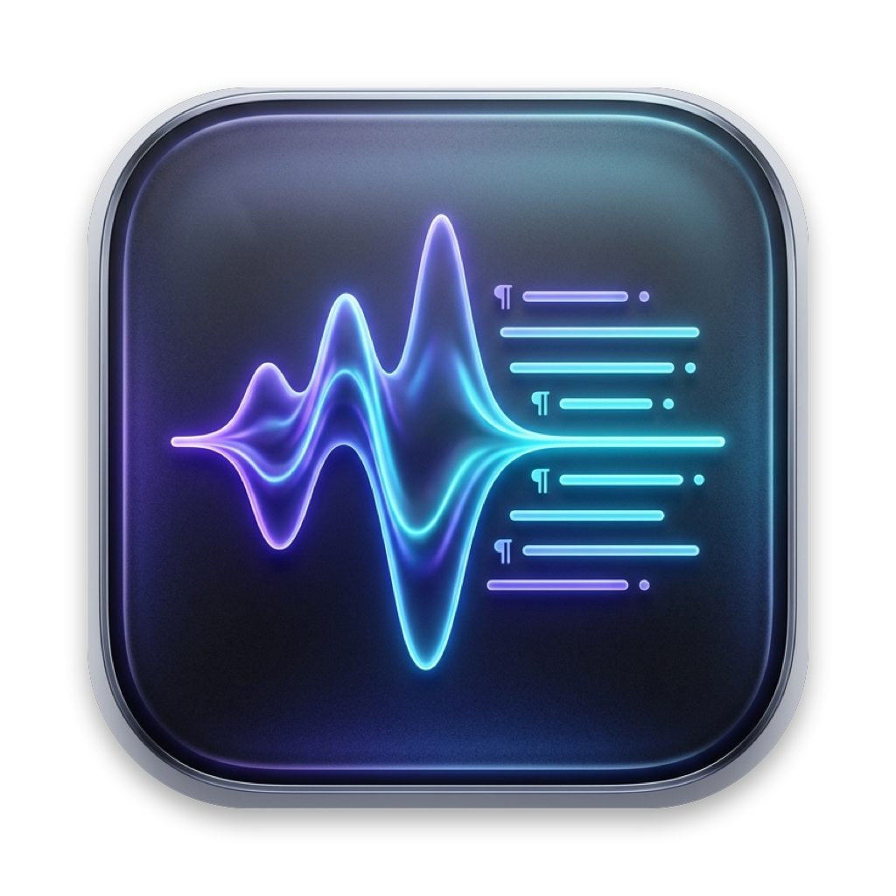
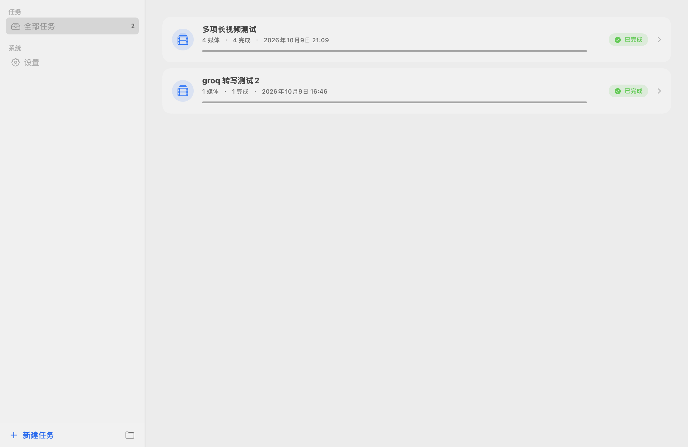
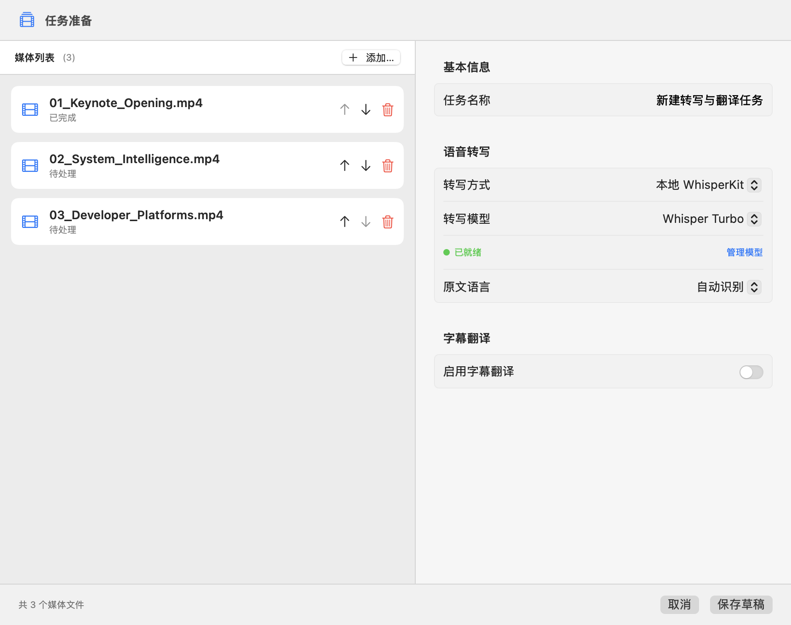
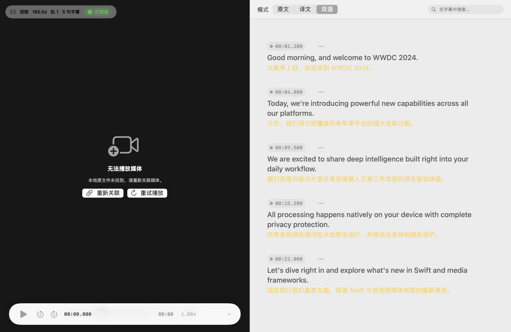
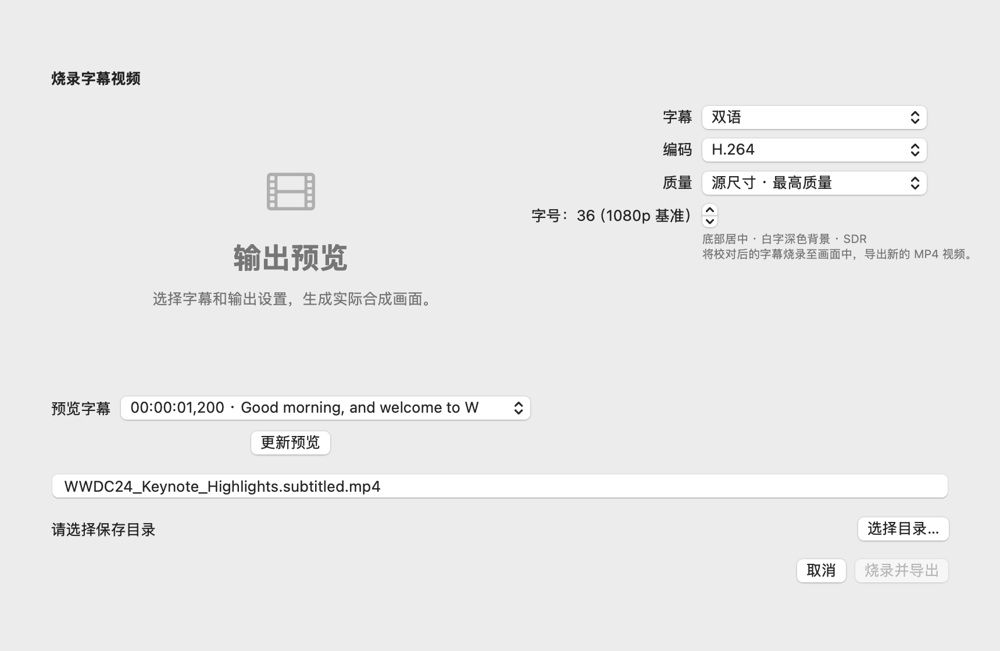
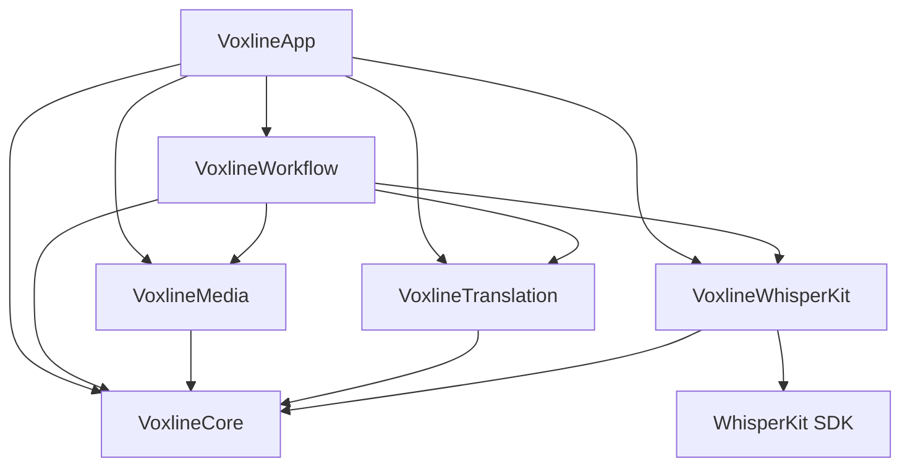

<div align="right">

**English** | [简体中文](README.zh-CN.md)

</div>

<div align="center">



# Voxline

**Subtitle transcription, translation, and proofreading workstation for macOS and iOS**

Native SwiftUI · WhisperKit · Apple Translation · Hard & Soft Subtitle Export · iCloud Sync

[](#building)
[](Package.swift)
[](LICENSE)

<table>
  <tr>
    <td width="50%"></td>
    <td width="50%"></td>
  </tr>
  <tr>
    <td width="50%"></td>
    <td width="50%"></td>
  </tr>
</table>

</div>

## Overview

**Voxline** is a subtitle tool built natively with SwiftUI, focused on **Apple native texture and system-level capabilities**.

It supports a complete end-to-end on-device processing workflow: local media import, on-device WhisperKit Core ML speech recognition, Apple native offline translation, synchronized bilingual proofreading, and native subtitle/video packaging and export.

## Features

- 📂 **Batch Media Pipeline** — Multi-file local media queue (MP4, MOV, M4V, M4A, MP3, WAV); automatically inspects container formats, durations, file sizes, and audio tracks.
- 🎙️ **On-Device WhisperKit Transcription** — Native integration of WhisperKit with Core ML hardware acceleration, supporting Tiny, Base, Small, Large v3, and Turbo models.
- ☁️ **Cloud Audio Transcription** — Cloud transcription fallback supporting OpenAI Audio Transcriptions, Google Gemini, and Alibaba Cloud DashScope / Qwen audio protocols.
- 📄 **Existing Subtitle Import** — Import SRT and VTT source subtitles and translations; MP4, MOV and M4V text subtitle tracks are imported automatically. Preview time-based translation matching and assign unmatched entries later.
- 🌐 **Dual Translation Engines** —
  - **Apple Translation**: Native offline translation powered by installed language models, zero configuration, and no API key required;
  - **OpenAI-Compatible LLM Translation**: Batch LLM translation with customizable batch sizes, model IDs, and system prompts.
- 🎧 **Bilingual Proofreading Player** — AVPlayer-backed player with Source, Translation, and Bilingual views, overlapping subtitles, millisecond-accurate subtitle timeline alignment, and waveform visualization for audio files.
- ✂️ **Timeline & Structure Editing** — Complete subtitle timeline operations: insert cues, fine-tune timing, natural sentence split, merge adjacent subtitles, and global timecode offsets.
- 🎞️ **Subtitle Export & Video Packaging** —
  - **SRT Export**: Export source, translated, or bilingual SRT subtitle files;
  - **Soft Subtitle Embedding**: Lossless MP4 muxing with selectable subtitle tracks;
  - **Hard Subtitle Burn-in**: Native GPU rendering via Core Image and AVAssetExportSession with customizable typography, sizing, and padding.
- 🛡️ **Atomic Checkpoints & Recovery** — Transcription segments and translation batches persist atomically, ensuring crashes, app quits, or cancellations never destroy finished work.
- 📲 **Multi-Device Continuity & Storage** — Export and import portable `.voxline` documents between macOS and iOS; sync tasks and subtitle progress via user-selected iCloud Drive folders.
- 🔄 **App Updates** — Sparkle checks and installs signature-verified Mac updates, waiting for active processing to stop before restarting. iOS provides version checks and IPA downloads for manual installation.
- 🎨 **Apple Native Texture & Interaction** — Fluid Liquid Glass materials, dark mode, VoiceOver accessibility labels, and HIG-compliant keyboard navigation.

## Installation

System requirements: macOS 15+ (Apple Silicon and Intel), iOS / iPadOS 18+.

### macOS

Homebrew

```bash
brew tap yamakze/voxline https://github.com/yamakze/Voxline.git
brew install --cask yamakze/voxline/voxline
```

Upgrade

```bash
brew update
brew upgrade --cask yamakze/voxline/voxline
```

Manual Download

Download from [Releases](https://github.com/yamakze/Voxline/releases/latest) and drag `Voxline.app` into **Applications**.

### iOS / iPadOS

Each release includes an unsigned `ipa`. Sideload with your preferred tool signed with your Apple ID:

- [AltStore](https://altstore.io) / [SideStore](https://sidestore.io)
- [Sideloadly](https://sideloadly.io)
- Xcode

## Building

Requires macOS 15+ and Xcode 26.2+ (Swift 6.2).

```bash
# macOS
make build            # Build the Mac app bundle (build/Voxline.app)
make run              # Rebuild and launch the Mac app
make test             # Run core test suites

# iOS
make ios              # Build for iOS Simulator
make ios-run          # Launch inside iOS Simulator
make ipa              # Build unsigned Release IPA (build/ios/Voxline-unsigned.ipa)
```

## Architecture

```
Sources/Voxline/
├── Core/               # ProcessingTask, SubtitleCue, TaskParameters domain models, SRT codecs, segmentation
├── Media/              # AVFoundation extractors, PCM slicing, audio inspection, burn-in rendering
├── Translation/        # OpenAI-compatible client, cloud transcription, Keychain credentials
├── WhisperKit/         # ModelManager, on-device WhisperKit integration, bounded audio providers
├── Workflow/           # TaskLibrary storage, TaskProcessingQueue, atomic checkpoints, sync
└── App/                # macOS & iOS SwiftUI views, Liquid Glass controls, sheets, navigation
```



For detailed architecture boundaries and engineering standards, see [Architecture & Boundaries](docs/architecture/README.md).

## Documentation

| Document | Purpose |
| --- | --- |
| [Development Workflow](docs/development.md) | Toolchain, signing identities, build commands, test suites, and local artifacts |
| [Data Handling & Privacy](docs/privacy.md) | Local processing, cloud endpoints, credential management, and sync boundaries |
| [Product Scope](docs/RFC/voxline-v1.md) | Product behavior, page specifications, and user interaction requirements |

## License

Voxline is open source under the [MIT License](LICENSE). Third-party dependencies and model weights retain their respective licenses (see [Licenses/README.md](Licenses/README.md)).
