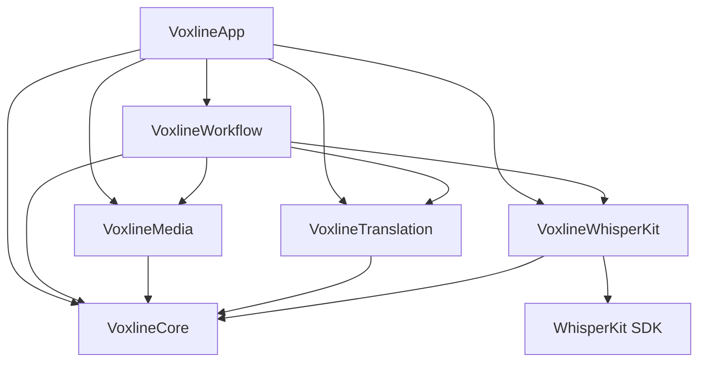

<div align="right">

**English** | [简体中文](README.zh-CN.md)

</div>

<div align="center">


# Voxline

**Native macOS & iOS client for subtitle transcription, translation, and proofreading**

Built with SwiftUI · 100% On-Device Processing · WhisperKit · Apple & Cloud Translation · Native Subtitles

[](#building)
[](Package.swift)
[](LICENSE)

<table>
  <tr>
    <td width="50%"></td>
    <td width="50%"></td>
  </tr>
  <tr>
    <td width="50%"></td>
    <td width="50%"></td>
  </tr>
</table>

</div>

## Overview

Inspired by the brilliant open-source project [妙幕 (SmartSub)](https://github.com/buxuku/SmartSub), **Voxline** reimagines subtitle workflows as a deeply integrated, high-performance native application crafted exclusively for Apple platforms (macOS 15+ and iOS 18+).

Emphasizing **pure Apple native design and craftsmanship**, Voxline is engineered with SwiftUI, system Liquid Glass materials, AVPlayer frame-synced playback, and Core Image GPU acceleration. It delivers an end-to-end **full on-device edge processing** pipeline: from local media inspection, offline Core ML speech-to-text via WhisperKit, zero-network Apple system translation, to synchronized bilingual proofreading and native video packaging. Your media, audio streams, and transcripts never leave your personal hardware, providing uncompromising privacy and lightning-fast local performance.

## Features

- 📂 **Batch Task Pipeline** — Multi-file local media queue (MP4, MOV, M4V, M4A, MP3, WAV); inspect container formats, codecs, duration, file size, and decodable audio tracks with language detection. Configure transcription models and translation settings per task.
- 🎙️ **Full On-Device WhisperKit Transcription** — Integrated WhisperKit engine supporting Tiny, Base, Small, Large v3, and Turbo models with Core ML hardware acceleration. Download, manage, and cache models locally. Audio stays entirely on your device with zero cloud leakage.
- ☁️ **Cloud Audio Transcription** — High-throughput cloud transcription options for resource-constrained devices or large batches, supporting OpenAI-compatible Audio Transcriptions (`/v1/audio/transcriptions`), Google Gemini Audio Chat, and Alibaba Cloud DashScope / Qwen Audio Chat protocols.
- 🌐 **Dual Translation Engines** —
  - **Apple Translation (100% Offline)**: Native, offline on-device translation powered by Apple system translation models. Zero configuration, zero API keys, and zero network traffic.
  - **OpenAI-Compatible LLM Translation**: Batch translation with sliding context windows, customizable batch sizes, custom models, and tailored system prompts for tone, terminology, and style.
- 🎧 **Interactive Proofreading Player** — AVPlayer-backed player with synchronized dual-language subtitles (Source, Translation, Bilingual modes), 0.5x–2.0x playback rates, ±5s jump, and instant timeline alignment upon clicking any subtitle cue. Audio-only media features smooth playback without synthetic video frames.
- ✂️ **Precision Subtitle Editing** — Complete timeline and cue manipulation: insert cues, fine-tune millisecond timestamps, natural sentence split based on punctuation and timecode midpoints, merge adjacent subtitles, and apply global timecode offsets.
- 🎞️ **Subtitle Export & Video Packaging** —
  - **SRT Export**: Export source, translated, or bilingual `.srt` external subtitle files anytime.
  - **Soft Subtitle Embedding**: Fast MP4 container muxing without re-encoding video frames, producing selectable subtitle tracks in milliseconds.
  - **Hard Subtitle Burn-in**: GPU-accelerated frame-by-frame subtitle rendering via Core Image and AVAssetExportSession with customizable typography and margins.
- 🛡️ **Atomic Checkpoints & Resilience** — Processing stages snapshot immutable parameters and committed evidence. Crashes, app quits, or cancellations preserve completed work and manual edits. Late API responses never overwrite proofread text.
- 📲 **Multi-Device Continuity & Security** — Portable `.voxline` task documents can be shared between macOS and iOS. Optional synchronization via user-selected iCloud Drive folders for tasks and subtitles with offline conflict preservation. API keys stay securely in the device Keychain.
- 🎨 **Apple Native Texture & Aesthetics** — Built from the ground up with SwiftUI, featuring Liquid Glass materials, dark mode, VoiceOver accessibility labels, and HIG-compliant keyboard navigation.

## Installation

Requires macOS 15+ (Universal: Apple Silicon and Intel) or iOS / iPadOS 18+.

### Homebrew (macOS)

Install via Voxline's self-hosted tap:

```bash
brew tap yamakze/voxline https://github.com/yamakze/Voxline.git
brew install --cask yamakze/voxline/voxline
```

To upgrade:

```bash
brew update
brew upgrade --cask yamakze/voxline/voxline
```

### Manual Download (macOS)

Download the latest `Voxline-x.y.z.zip` from [Releases](https://github.com/yamakze/Voxline/releases/latest), unzip, and drag it into **Applications**.

### iOS / iPadOS (Sideloading)

Each release includes an **unsigned** `Voxline-iOS-x.y.z.ipa` for iOS 18+. Install it using your preferred sideloading tool signed with your Apple ID:

- [AltStore](https://altstore.io) / [SideStore](https://sidestore.io)
- [Sideloadly](https://sideloadly.io)
- Xcode (Devices and Simulators)

## Building

Requires macOS 15+ and Xcode 26.2+ (Swift 6.2).

```bash
# macOS
make build            # Build the Mac app bundle (.build/app/Voxline.app)
make run              # Rebuild and launch the Mac app
make test             # Run core test suites

# iOS
make ios              # Build for iOS Simulator
make ios-run          # Launch inside iOS Simulator
make ipa              # Build unsigned Release IPA (build/ios/Voxline-unsigned.ipa)
```

## Architecture

Voxline enforces a strict unidirectional dependency graph across 6 distinct modules:

```
Sources/Voxline/
├── Core/               # ProcessingTask, SubtitleCue, TaskParameters, SRT codecs, segmentation
├── Media/              # AVFoundation extractors, PCM slicing, audio inspection, burn-in rendering
├── Translation/        # OpenAI chat client, Cloud transcription, Keychain credentials
├── WhisperKit/         # ModelManager, on-device WhisperKit integration, bounded audio providers
├── Workflow/           # TaskLibrary storage, TaskProcessingQueue, atomic checkpoints, sync
└── App/                # macOS & iOS SwiftUI views, Liquid Glass controls, sheets, navigation
```



Domain models are strictly value-typed (`Sendable`), and execution boundaries maintain atomic persistence guarantees. For detailed architecture boundaries and engineering standards, see [docs/architecture/README.md](docs/architecture/README.md).

## Documentation

| Document | Purpose |
| --- | --- |
| [Architecture & Boundaries](docs/architecture/README.md) | Module responsibilities, persistence, processing pipelines, and platform rules |
| [Development Workflow](docs/development.md) | Toolchain, signing identities, build commands, test suites, and local artifacts |
| [Data Handling & Privacy](docs/privacy.md) | Local processing, cloud endpoints, credential management, and sync boundaries |
| [Product Scope](docs/RFC/voxline-v1.md) | Product behavior, page specifications, and user interaction requirements |

## License

Voxline is open source under the [MIT License](LICENSE). Third-party dependencies and model weights retain their respective licenses (see [Licenses/README.md](Licenses/README.md)).
