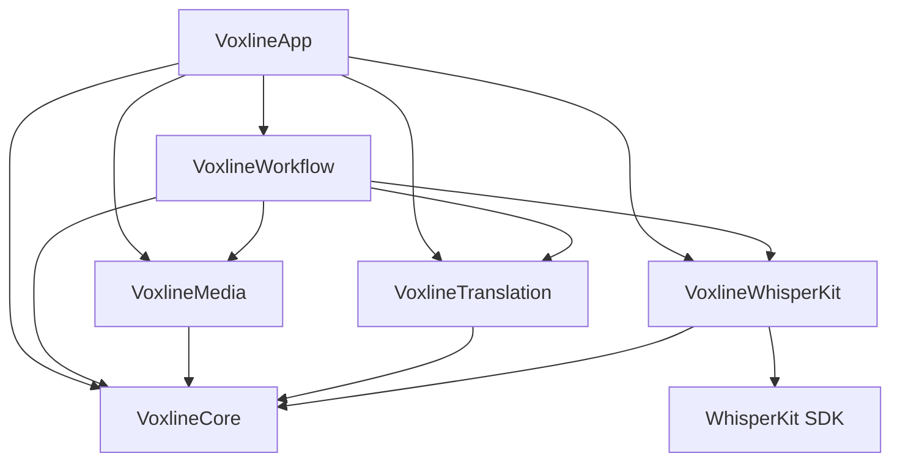

<div align="right">

[English](README.md) | **简体中文**

</div>

<div align="center">


# Voxline

**macOS 与 iOS 音视频字幕转写、翻译与校对工作台**

SwiftUI 原生构建 · WhisperKit · Apple Translation · 软硬字幕导出 · iCloud 同步

[](#构建与运行)
[](Package.swift)
[](LICENSE)

<table>
  <tr>
    <td width="50%"></td>
    <td width="50%"></td>
  </tr>
  <tr>
    <td width="50%"></td>
    <td width="50%"></td>
  </tr>
</table>

</div>

## 产品简介

**Voxline** 是一款追求 **Apple 原生质感与系统级能力**的音视频字幕工具，采用 SwiftUI 原生构建。

项目支持全流程端侧处理：本地媒体导入、WhisperKit 端侧 Core ML 语音识别、Apple 本机翻译、双语校对与视频字幕封装导出。

## 功能特性

- 📂 **批量媒体流水线** — 多选导入本地音视频文件（MP4、MOV、M4V、M4A、MP3、WAV），自动解析封装格式、时长、体积及多音轨信息。
- 🎙️ **WhisperKit 本地转写** — 原生集成 WhisperKit 引擎与 Core ML 硬件加速，支持 Tiny、Base、Small、Large v3 与 Turbo 全系列模型
- ☁️ **云端音频转写** — 提供云端转写补充，支持 OpenAI Audio Transcriptions、Google Gemini 与阿里云百炼 Qwen 音频协议。
- 📄 **已有字幕导入** — 导入 SRT、VTT 原文与译文；添加 MP4、MOV、M4V 视频时自动读取文本字幕轨。译文支持按时间匹配与预览，未匹配内容可保留并稍后分配。
- 🌐 **双引擎翻译** —
  - **Apple 本机翻译**：系统原生离线翻译，已下载语言包即可完全离线运行，免配置 API Key；
  - **OpenAI 兼容 LLM 翻译**：LLM 批量翻译，支持自定义单批字幕数量、模型 ID 与系统提示词。
- 🎧 **双语校对播放器** — 基于原生 AVPlayer 构建，支持原文、译文与双语对照三种视图、重叠字幕与毫秒级字幕定位跳转，支持纯音频声波视图播放。
- ✂️ **时间轴与结构编辑** — 完备的字幕轴时间线操作：单句插入、逐句起止时间微调、自然断句拆分、相邻字幕一键合并、时间轴全局平移。
- 🎞️ **字幕导出与视频封装** —
  - **SRT 导出**：导出原文、译文或双语 SRT 外挂字幕文件；
  - **内封软字幕**：无损封装含独立字幕轨的 MP4 视频；
  - **硬字幕压制**：基于 Core Image 与 AVAssetExportSession 原生 GPU 烧录，支持自定义字体、尺寸与排版边距。
- 🛡️ **原子检查点与断点续做** — 转写分段与翻译批次持久化落地;保证应用退出、崩溃或手动取消不损坏成果
- 📲 **跨设备协同与存储** — 支持通过 `.voxline` 文档在 macOS 与 iOS 之间导入导出；支持用户 iCloud Drive 共享文件夹同步任务与字幕进度；
- 🔄 **应用更新** — Mac 通过 Sparkle 检查更新、验证更新包签名并安装，正在处理任务时等待队列停止后重启；iOS 支持版本检查与 IPA 下载，安装由用户自行完成。
- 🎨 **Apple 原生质感与交互** — 适配 Liquid Glass 流体玻璃材质、深色模式、VoiceOver 辅助功能标签与符合 HIG 规范的键盘快捷键导航。

## 安装与使用

系统要求：macOS 15+（支持 Apple Silicon 与 Intel 架构）、 iOS / iPadOS 18+。

### macOS

Homebrew

```bash
brew tap yamakze/voxline https://github.com/yamakze/Voxline.git
brew install --cask yamakze/voxline/voxline
```

更新

```bash
brew update
brew upgrade --cask yamakze/voxline/voxline
```

手动下载

从 [Releases](https://github.com/yamakze/Voxline/releases/latest) 下载，将 `Voxline.app` 拖入「应用程序」文件夹即可。

### iOS / iPadOS

每次发版均附带未签名的 `ipa`。使用您偏好的侧载工具配合个人 Apple ID 签名安装：

- [AltStore](https://altstore.io) / [SideStore](https://sidestore.io)
- [Sideloadly](https://sideloadly.io)
- Xcode

## 构建与运行

要求 macOS 15+ 与 Xcode 26.2+（Swift 6.2）。

```bash
# macOS
make build            # 编译 Mac 应用包（build/Voxline.app）
make run              # 重新编译并直接启动 Mac 应用
make test             # 运行核心工作流与领域测试套件

# iOS
make ios              # 为 iOS 模拟器构建
make ios-run          # 在 iOS 模拟器中安装并启动
make ipa              # 构建未签名的 Release IPA（build/ios/Voxline-unsigned.ipa）
```

## 架构设计

```
Sources/Voxline/
├── Core/               # ProcessingTask、SubtitleCue、TaskParameters 领域模型、SRT 编解码、断句切分
├── Media/              # AVFoundation 音频提取、PCM 采样切片、音轨检查、Core Image 烧录渲染
├── Translation/        # OpenAI 兼容客户端、云端转写协议、Keychain 凭据加密存储
├── WhisperKit/         # ModelManager 模型管理、端侧 WhisperKit 集成与生命周期调度
├── Workflow/           # TaskLibrary 持久化存储、TaskProcessingQueue 顺序队列、原子检查点与同步
└── App/                # macOS 与 iOS 平台适配、SwiftUI 视图、Liquid Glass 控件、弹窗与导航
```



详细架构边界与工程规则参见 [工程架构与设计边界](docs/architecture/README.md)。

## 文档

| 文档 | 职责说明 |
| --- | --- |
| [开发工作流与测试](docs/development.md) | 工具链环境、代码签名、编译命令、测试套件与本地产物 |
| [数据处理与隐私说明](docs/privacy.md) | 本地离线处理、云端协议、系统 Keychain 凭据管理与同步边界 |
| [产品需求与设计规格](docs/RFC/voxline-v1.md) | 产品功能定义、页面交互细节与两端能力设计规范 |

## 开源许可

Voxline 采用 [MIT 许可证](LICENSE) 开源。第三方开源组件与模型权重保留其各自的许可证（详见 [Licenses/README.md](Licenses/README.md)）。
