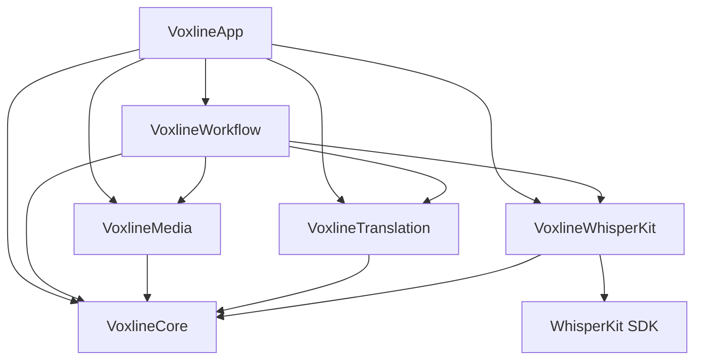

<div align="right">

[English](README.md) | **简体中文**

</div>

<div align="center">


# Voxline

**原生 macOS 与 iOS 音视频字幕转写、双语翻译与校对工作台**

SwiftUI 原生打造 · 全端侧离线处理 · WhisperKit · Apple 本机翻译与云端协议 · 原生软硬字幕

[](#构建与运行)
[](Package.swift)
[](LICENSE)

<table>
  <tr>
    <td width="50%"></td>
    <td width="50%"></td>
  </tr>
  <tr>
    <td width="50%"></td>
    <td width="50%"></td>
  </tr>
</table>

</div>

## 产品简介

**Voxline** 的灵感源自优秀开源项目 [妙幕 (SmartSub)](https://github.com/buxuku/SmartSub)。我们在此基础上，专为 Apple 平台（macOS 15+ 与 iOS 18+）打造了一款高度整合、性能卓越的原生音视频字幕工作台。

Voxline 深度追求 **Apple 原生质感与系统级能力**，全面采用 SwiftUI 构建，深度集成系统 Liquid Glass 流体玻璃材质、AVPlayer 音画精准对齐时钟与 Core Image GPU 硬件渲染。同时，项目主打**全端侧离线闭环处理**：从本地媒体导入、WhisperKit 端侧 Core ML 离线语音识别、Apple 本机完全离线翻译，到同步双语交互校对与原生视频封装，原始音频与转写文本全程不脱离本地设备，实现极致的隐私安全与丝滑响应。

## 功能特性

- 📂 **批量媒体流水线** — 多选导入本地音视频文件（MP4、MOV、M4V、M4A、MP3、WAV），自动解析封装格式、时长、体积及多音轨信息；每个任务独立指定转写模型、原文语言、翻译引擎与目标语言。
- 🎙️ **全端侧 WhisperKit 本地转写** — 原生集成 WhisperKit 引擎与 Core ML 硬件加速，支持 Tiny、Base、Small、Large v3 与 Turbo 全系列模型；模型按需下载并本地缓存，音频 100% 本地离线处理，隐私零泄漏。
- ☁️ **云端高吞吐音频转写** — 针对低算力设备或超长素材提供云端转写算力补充，支持 OpenAI 兼容 Audio Transcriptions（`/v1/audio/transcriptions`）、Google Gemini 音频聊天协议与阿里云百炼 Qwen 音频聊天协议。
- 🌐 **双引擎智能翻译** —
  - **Apple 本机翻译（全端侧离线）**：系统级原生离线翻译，已下载语言包即可完全离线运行，免配置 API Key，零网络流量消耗，高效安全；
  - **OpenAI 兼容 LLM 翻译**：大语言模型批量翻译，具备前后上下文语义感知，支持自定义单批字幕数量、模型 ID 与专属系统提示词（定制语气、专业术语或风格）。
- 🎧 **沉浸式双语校对播放器** — 基于原生 AVPlayer 深度构建，支持原文、译文与双语对照三种视图，0.5x ~ 2.0x 变速回放，±5s 快速快进快退；轻点单句字幕毫秒级定位跳转，纯音频同样支持声波视图播放。
- ✂️ **精细化时间轴与结构编辑** — 完备的字幕轴时间线操作：单句插入、逐句起止时间毫秒级微调、基于标点符号与时间中点的自然断句拆分（智能分割长句）、相邻字幕一键合并、整轨时间轴全局毫秒级平移。
- 🎞️ **字幕导出与视频封装** —
  - **SRT 导出**：随时导出原文、译文或双语 SRT 外挂字幕文件；
  - **内封软字幕**：无需重新编码视频画面，毫秒级无损封装生成包含独立可选字幕轨的 MP4 视频；
  - **硬字幕压制**：基于 Core Image 与 AVAssetExportSession 原生 GPU 逐帧渲染烧录，自定义字体、尺寸与排版边距。
- 🛡️ **原子检查点与断点续做** — 任务执行冻结参数快照，转写分段与翻译批次持久化落地；应用退出、崩溃或手动取消不损坏已完成成果与人工校对，迟到响应绝不覆盖最新手工修改，单项失败可独立重试。
- 📲 **跨设备协同与安全存储** — 支持通过 `.voxline` 原生任务文档在 macOS 与 iOS 之间导入导出；支持用户授权的 iCloud Drive 共享文件夹进行任务与字幕同步（音视频源媒体可按需开启同步）；API 密钥安全存放在系统 Keychain，不进入任务文件。
- 🎨 **Apple 原生质感与交互** — 全面采用 SwiftUI 构建，适配 Liquid Glass 流体玻璃材质、深色模式、VoiceOver 辅助功能标签与符合 HIG 规范的键盘快捷键导航。

## 安装与使用

系统要求：macOS 15+（Universal：Apple Silicon 与 Intel 架构均原生支持）或 iOS / iPadOS 18+。

### Homebrew (macOS)

通过 Voxline 自托管 Tap 安装：

```bash
brew tap yamakze/voxline https://github.com/yamakze/Voxline.git
brew install --cask yamakze/voxline/voxline
```

更新已安装应用：

```bash
brew update
brew upgrade --cask yamakze/voxline/voxline
```

### 手动下载 (macOS)

从 [Releases](https://github.com/yamakze/Voxline/releases/latest) 下载最新的 `Voxline-x.y.z.zip`，解压后将 `Voxline.app` 拖入「应用程序」文件夹即可。

### iOS / iPadOS（侧载）

每次发版均附带未签名的 `Voxline-iOS-x.y.z.ipa`。请使用您偏好的侧载工具配合个人 Apple ID 签名安装：

- [AltStore](https://altstore.io) / [SideStore](https://sidestore.io)
- [Sideloadly](https://sideloadly.io)
- Xcode (Devices and Simulators)

## 构建与运行

要求 macOS 15+ 与 Xcode 26.2+（Swift 6.2）。

```bash
# macOS
make build            # 编译 Mac 应用包（.build/app/Voxline.app）
make run              # 重新编译并直接启动 Mac 应用
make test             # 运行核心工作流与领域测试套件

# iOS
make ios              # 为 iOS 模拟器构建
make ios-run          # 在 iOS 模拟器中安装并启动
make ipa              # 构建未签名的 Release IPA（build/ios/Voxline-unsigned.ipa）
```

## 架构设计

Voxline 在 6 个核心模块之间遵循严格的单向无环依赖原则：

```
Sources/Voxline/
├── Core/               # ProcessingTask、SubtitleCue、TaskParameters 领域模型、SRT 编解码、断句切分
├── Media/              # AVFoundation 音频提取、PCM 采样切片、音轨检查、Core Image 烧录渲染
├── Translation/        # OpenAI 兼容客户端、云端转写协议、Keychain 凭据加密存储
├── WhisperKit/         # ModelManager 模型管理、端侧 WhisperKit 集成与生命周期调度
├── Workflow/           # TaskLibrary 持久化存储、TaskProcessingQueue 顺序队列、原子检查点与同步
└── App/                # macOS 与 iOS 平台适配、SwiftUI 视图、Liquid Glass 控件、弹窗与导航
```



领域模型为纯粹的值类型（`Sendable`），执行边界具备严格的原子持久化保证。详细架构边界与工程规则参见 [docs/architecture/README.md](docs/architecture/README.md)。

## 文档

| 文档 | 职责说明 |
| --- | --- |
| [工程架构与设计边界](docs/architecture/README.md) | 模块职责划分、持久化设计、处理流水线与平台工程规则 |
| [开发工作流与测试](docs/development.md) | 工具链环境、代码签名、编译命令、测试套件与本地产物 |
| [数据处理与隐私说明](docs/privacy.md) | 本地离线处理、云端协议、系统 Keychain 凭据管理与同步边界 |
| [产品需求与设计规格](docs/RFC/voxline-v1.md) | 产品功能定义、页面交互细节与两端能力设计规范 |

## 开源许可

Voxline 采用 [MIT 许可证](LICENSE) 开源。第三方开源组件与模型权重保留其各自的许可证（详见 [Licenses/README.md](Licenses/README.md)）。
