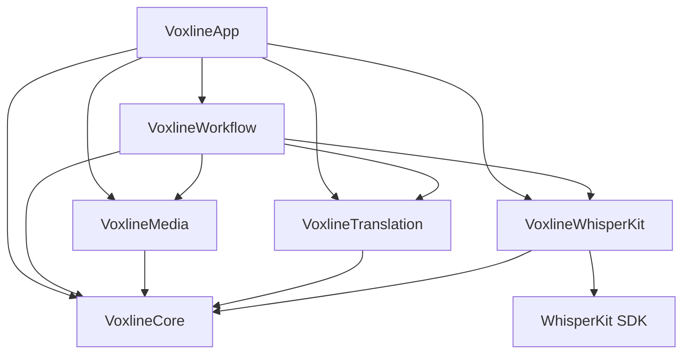

# 工程架构与设计边界

采用 SwiftPM，iOS 采用 Xcode 工程。依赖提交由 Package.swift / Package.resolved 锁定。

## 平台分层与代码组织

源码位于 `Sources/Voxline/`，划分为 6 个职责明确的模块：

```
Sources/Voxline/
├── Core/               # 领域模型、状态机、SRT 编解码、断句切分
├── Media/              # AVFoundation 音频提取、播放控制、原生软硬字幕导出
├── Translation/        # OpenAI 兼容客户端、Apple 本机翻译、云端转写协议、Keychain 凭据
├── WhisperKit/         # ModelManager 模型管理、端侧 WhisperKit 集成与生命周期调度
├── Workflow/           # TaskLibrary 持久化、单执行者 TaskProcessingQueue、原子检查点与同步
└── App/                # macOS 与 iOS 平台适配、SwiftUI 原生页面、材质控件与交互接线
```

### 依赖关系与禁止模式

模块之间遵循严格的单向无环依赖原则：



- **禁止底层反向依赖上层**：Core、Media、Translation、WhisperKit 与 Workflow 严禁导入 AppKit、UIKit 或 App 视图模块。
- **Core 纯粹性保证**：VoxlineCore 只依赖 Foundation 与系统基本类型；严禁引入 AVFoundation、Core ML、UI 框架或第三方 SDK。
- **SDK 隔离**：第三方 WhisperKit SDK 仅由 `VoxlineWhisperKit` 模块导入并封装，上层 UI 与工作流通过 `ModelManager` 协议交互，不直接暴露 SDK 内部类型。
- **值类型与并发安全**：领域实体（`ProcessingTask`、`SubtitleCue`、`TaskParameters`）均为不可变或纯值类型（`Sendable`），在 Actor 间安全流转。

---

## 模块职责规范

### 1. VoxlineCore
- **领域模型**：`ProcessingTask`（任务根对象）、`MediaItem`（单媒体条目）、`SubtitleCue`（字幕句与时间戳）、`TaskParameters`（冻结参数快照）。
- **执行检查点**：`MediaProcessingCheckpoint` 记录转写分块与翻译批次的提交状态与未完成证据。
- **SRT 编解码**：纯文本 SRT 解析器与生成器，支持原文、译文与双语三种导出投影。
- **字幕断句切分**：`SubtitleSegmenter` 基于词级/段级时间戳、标点符号中点与时间中点进行自然分割。

### 2. VoxlineMedia
- **媒体能力检查**：`MediaInspector` 快速读取容器元数据、时长、多语言音轨，并以头尾采样计算媒体采样指纹。
- **音频提取**：`AudioExtractor` 通过 `AVAssetReader` 提取所选音轨，输出 16 kHz 单声道 Float32 PCM，并分块（最多 120 秒）落盘缓存。
- **播放器控制**：`MediaPlaybackController` 封装 `AVPlayer`，支持 0.5x ~ 2.0x 变速回放、±5s 跳转、精确二分定位字幕时间线，向 UI 发布时钟与活动字幕索引。
- **原生字幕烧录**：`SubtitleBurnInExporter` 基于 Core Image 滤镜与 `AVAssetExportSession`，在 GPU 上逐帧渲染烧录硬字幕，支持自定义字号、自动换行与居中排版。
- **内封软字幕**：`SubtitleEmbeddingExporter` 利用 `AVAssetReader` 与 `AVAssetWriter`，将视频与所选音轨压缩样本直通封装为 MP4，并写入独立 tx3g 字幕轨。

### 3. VoxlineWhisperKit
- **模型管理**：`WhisperModelStore` 与 `ModelManager` 管理 Tiny、Base、Small、Large v3、Turbo 5 种型号的下载、校验、本地磁盘占用统计与删除。
- **生命周期调度**：同一进程复用唯一已加载模型实例；切换模型时先释放旧实例再加载新模型；空闲时自动卸载，避免显存泄露。
- **有界转写 Provider**：`WhisperKitTranscriptionProvider` 接收最多 120 秒 PCM 输入，执行 Core ML 硬件加速推理，记录原始对齐证据。

### 4. VoxlineTranslation
- **Apple 本机翻译**：`AppleTranslationCoordinator` 协调系统级离线翻译会话，核对系统语言包安装状态，实现完全离线端侧翻译。
- **OpenAI 兼容翻译**：`OpenAICompatibleTranslationClient` 执行批量字幕翻译，提供滑动窗口上下文（前后各 2 句）、自定义批量大小、以及系统提示词定制。
- **云端转写协议**：`CloudTranscriptionProtocol` 支持 OpenAI Audio Transcriptions、Google Gemini Audio Chat 与阿里云百炼 Qwen Audio Chat 协议。
- **安全凭据存储**：`KeychainTranslationCredentialVault` 将 API Key 异步安全保存在设备本机 Keychain，不进入任务文件或同步文档。

### 5. VoxlineWorkflow
- **任务存储**：`TaskLibrary` 管理本地 `.voxline` 任务文档的读写、任务顺序（`task-order.json`）与删除清理。
- **执行队列**：`TaskProcessingQueue` 进程内单执行者顺序队列，驱动音频提取、转写与翻译流水线，处理取消、失败隔离与断点恢复。
- **原子检查点提交**：将转写完成块与翻译批次原子落盘至任务文件。
- **iCloud 同步协调**：`TaskSyncCoordinator` 协调用户授权的共享 iCloud Drive 文件夹，基于 `NSFileCoordinator` 与 `NSFileVersion` 实现版本与冲突保护。

### 6. VoxlineApp
- **跨平台适配**：`Platform/macOS` 与 `Platform/iOS` 分别处理窗口/标签页导航、原生文件选择器与触摸手势。
- **共享视图**：任务列表、参数配置会话（`TaskConfigurationSession`）、双语校对播放器（`MediaDetailProofreadingView`）、字幕结构编辑器（`SubtitleStructureEditor`）与设置面板。
- **视觉风格**：系统 26+ 使用 Liquid Glass 流体玻璃，旧系统使用原生 Material，全面适配深色模式与 VoiceOver 辅助功能。

---

## 核心设计与数据流

### 1. Task 持久化与原子检查点

- **文件格式**：任务根对象为 `ProcessingTask`（版本 7），持久化保存为 `.voxline` 纯 JSON 文档。
- **参数冻结**：任务启动时冻结当前参数快照（`TaskParameters`）；修改全局设置默认值不影响已有任务。
- **停止后参数调整**：任务停止后支持显式修改转写模型、翻译引擎与目标语言；已有字幕成果完整保留。更换目标语言需明确确认，自动将已有译文重置为待翻译。
- **原子提交**：`TaskLibrary.commitCheckpoint` 在内存中生成副本、核对版本并原子替换任务文件。保存失败保留界面草稿，绝不损坏磁盘文件。
- **防覆盖保护**：迟到的云端响应或异步回调在提交前严格核对当前字幕原文版本与人工编辑快照；若用户已手工修改，迟到响应拒绝覆盖。

### 2. 本地顺序执行与容错恢复

- **单执行者队列**：`TaskProcessingQueue` 保证同一时间只有一个任务条目占用硬件推理与转写资源，避免 GPU/ANE 显存争抢。
- **阶段状态解耦**：音频提取、语音转写、双语翻译各自独立落盘检查点。单项失败（如某一段网络超时）仅将该项标记为失败并保留错误诊断，不阻塞队列中其他合法媒体。
- **断点续做**：进程重启或手动中断后，恢复计划仅提取未完成的转写块与无有效译文的字幕，已完成的块直接复用，不重复跑模型。

### 3. 全端侧离线闭环处理

Voxline 核心主打端侧离线闭环能力：
1. **输入阶段**：本地音视频经由沙盒安全书签打开，不向外部服务器上传音频文件。
2. **转写阶段**：Core ML 加速的 WhisperKit 纯本地运行，权重常驻设备沙盒。
3. **翻译阶段**：通过 Apple Translation 原生框架，利用系统下载的离线语言包在本地完成推理。
4. **校对与导出**：本地 AVPlayer 同步播放，GPU 本地渲染烧录或无损封装 MP4。
全程无需联网，确保绝对的数据主权与隐私安全。

---

## 资源管理与本地化

- **多语言资源**：简体中文与英文资源按模块归属于各自的 `Resources/*.lproj`（如 `Localizable.strings` 与 `Localizable.stringsdict`）。
- **原生提取与调用**：使用 Foundation 原生 `String(localized:bundle:)`，保留字符串字面量以便编译器提取。
- **应用图标与元数据**：iOS 使用资源目录软链接 `Resources/AppIcon.png`，macOS 使用 `Resources/AppIcon.icns`。版本号统一由根目录 `Version.xcconfig` 的 `MARKETING_VERSION` 驱动。
