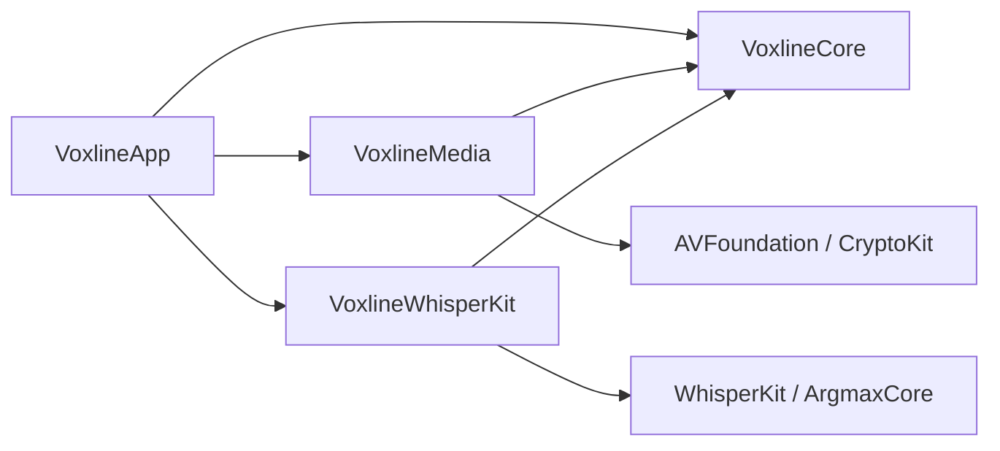

# 当前工程边界

Voxline 采用 Swift 6.2 / SwiftPM 构建 macOS 15 应用，Scripts/build-app.sh 生成本地签名的 .app。SDK 固定为 Argmax v1.1.0 的确切提交；Package.resolved 锁定依赖图。只链接 WhisperKit 产品，未采用上游包含 TTSKit 的完整 CLI。

- VoxlineCore：ProcessingTask、参数快照、有序媒体条目、字幕版本、媒体身份、JSON 编解码与验证、转写边界协议。只依赖 Foundation；保存条目处理状态，不保存设备路径、书签或密钥。
- VoxlineWhisperKit：具体 SDK 的本地模型配置边界。SDK 类型只存在于该模块内部；模型可用性、下载、Provider 与恢复由对应任务实现。
- VoxlineMedia：原生音视频能力检查、流式 SHA-256 与设备本地媒体书签。AVFoundation 类型不进入 Core 或项目格式；导入不复制视频。书签存于应用本地 Application Support，并与项目 ID、文件身份和音轨绑定。
- VoxlineApp：SwiftUI 任务列表、Task 文档场景、任务准备、任务概览、媒体列表与字幕浏览。界面通过绑定修改 Task 和条目，DocumentGroup / FileDocument 负责文件生命周期；设备媒体访问状态由 MediaItemSession 管理。TaskLibrary 只保存内存中的界面摘要，最近文件复用 NSDocumentController，不另存任务成果。

项目保存前和读取后都验证格式、ID、时间、媒体边界与译文来源。损坏或未来版本抛出错误，不创建空项目替代原数据。新项目的空媒体和空字幕是显式草稿状态。

原始 ASR 证据与可读字幕分开：RawTranscriptionSegment 允许保留异常对齐，转换为 SubtitleCue 前必须验证。字幕切分和 Provider 不能排序、裁剪或丢弃文本来伪装成功。过期译文保留旧来源，在界面中显示待重译。

禁止 UI 或 Core 导入 WhisperKit；禁止 Pipeline 直接覆盖受文档系统管理的文件；禁止将 JSON、SRT 与数据库同时作为字幕权威来源；禁止将本地书签、模型、密钥、临时音频或执行租约写进字幕成果。

当前文档为格式版本 2 的 `.voxline` Task JSON，版本 1 的旧单媒体项目经验证后迁移。设备书签与重新关联在 VoxlineMedia 管理，按媒体条目 ID 复用原访问记录；缺失记录、失效授权、损坏记录和内容不符均明确显示。打开媒体重新检查文件，过期书签经身份验证后更新。iCloud 功能暂废弃；实际队列与分段恢复仍由对应条目实施。

应用打包启用 App Sandbox、用户选择文件读写、应用范围书签及网络客户端权限。持久视频书签限定只读；网络客户端供所选模型与 API 路线使用。能力查询和书签 API 依据 [Apple 音轨解码文档](https://developer.apple.com/documentation/avfoundation/avassettrack/isdecodable) 与 [Apple 书签解析文档](https://developer.apple.com/documentation/foundation/url/init%28resolvingbookmarkdata%3Aoptions%3Arelativeto%3Abookmarkdataisstale%3A%29-3ic6f)。

格式与工作流：[ADR-0005](../ADR/0005-task-document-format.md)。旧单媒体格式背景见 [ADR-0002](../ADR/0002-m1-baseline-and-project-document.md)。

## Task 数据与界面边界

VXL-046 已引入 ProcessingTask、参数冻结、独立媒体条目、本地文档读写和旧数据迁移。VXL-047 已加入任务列表、准备表单、任务概览与媒体导航。TaskLibraryView 打开系统文档；TaskConfigurationView 在独立草稿上选择参数、检查多选视频、明确音轨并保存本地关联，全部成功后提交同一 Task 绑定。取消和检查失败不改写文档，提交期间原任务变化则明确拒绝覆盖。

TaskDocumentView 管理概览与媒体导航，TaskOverviewView 从条目计算完成数量并显示逐项真实状态、原因和本次参数。MediaItemView 复用既有视频关联与字幕浏览。转写、翻译、重试、播放和编辑尚未接通，界面明确显示可用范围。VXL-026 负责单执行队列，VXL-015／016 负责播放校对；未接通能力不产生空壳操作或伪造完成状态。

Task 本地持久化复用 JSON 编解码、系统文档写入和媒体访问能力。SubtitleProject 仅作为旧格式迁移输入，不在 Task 中保留第二份字幕或配置。Task 参数冻结后不可更改，整体状态由条目计算；重开时运行条目转为待恢复。纯数据和服务边界保持在 Core，SDK 与 AVFoundation 类型不进入 Task。

界面按任务列表 → 任务准备 → 任务概览 → 媒体详情组织，采用系统窗口、侧栏、列表、工具栏、表单、sheet 和文件选择面板。NativeControlSurface 在系统 26 及以上使用原生 glassEffect，旧系统使用 regularMaterial；减少透明度时使用系统不透明控制背景。媒体与字幕内容使用标准内容背景，界面不添加自定义过渡或循环动画。

全文件哈希仅在确有身份或重新关联需求时使用，去除打开／确认阶段的重复扫描。保留沙盒访问、明确失败、成果恢复与编辑保护，禁止引入账户角色、云冲突处理和没有使用场景的策略层。当前代码中重复扫描的收敛列入 VXL-006。

当前长期决定：[ADR-0004](../ADR/0004-task-workflow-and-native-design.md)。
