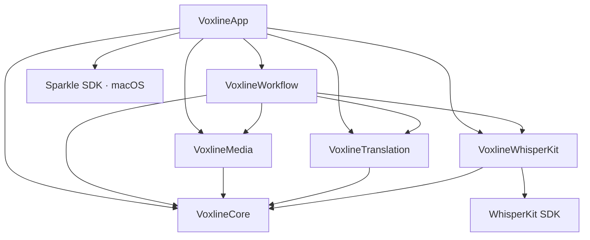

# 工程架构与设计边界

macOS 构建采用 SwiftPM，iOS 构建采用 Xcode 工程。两端依赖由根目录 `Package.swift` 与 `Package.resolved` 统一管理与版本锁定。

## 平台分层与代码组织

源码位于 `Sources/Voxline/`，划分为 6 个单一职责模块：

```
Sources/Voxline/
├── Core/               # 领域模型、状态机、SRT 编解码、断句切分
├── Media/              # 音频提取、播放控制、字幕时间线、音视频导出与封装
├── Translation/        # OpenAI 兼容协议、Apple 本机翻译、云端转写协议、Keychain 凭据
├── WhisperKit/         # ModelManager 模型管理、WhisperKit 调度与硬件推理
├── Workflow/           # TaskLibrary 持久化、单执行者任务队列、检查点提交与同步
└── App/                # macOS 与 iOS 界面、SwiftUI 页面、材质组件与交互绑定
```

### 依赖关系与架构边界

模块间遵循单向无环依赖约束：



- **单向无环依赖**：底层模块（Core、Media、Translation、WhisperKit、Workflow）严禁反向导入上层 AppKit、UIKit 或 App 视图层。
- **Core 纯粹性**：VoxlineCore 仅依赖 Foundation 与系统基础类型，不引入音视频处理、Core ML、UI 框架或第三方库。
- **第三方 SDK 封装**：WhisperKit SDK 仅由 `VoxlineWhisperKit` 模块导入并隔离，工作流与界面层通过内部协议与类型交互，不直接暴露外部 SDK 数据结构。
- **并发与值类型语义**：核心领域实体（`ProcessingTask`、`SubtitleCue`、`TaskParameters`）均为 `Sendable` 纯值类型，支持在并发任务与 Actor 边界间安全传递。

## 模块职责

### VoxlineCore
- **领域实体**：定义根任务 `ProcessingTask`、媒体条目 `TaskMediaItem`、字幕行 `SubtitleCue` 与参数快照 `TaskParameters`。
- **执行检查点**：维护 `MediaProcessingCheckpoint`，记录分块转写与分批翻译的执行进度与诊断证据。
- **SRT 编解码**：纯文本 SRT 解析器与生成器，支持原文、译文与双语三种导出投影。
- **断句切分**：`SubtitleSegmenter` 基于词级/段级时间戳、标点中点与时间区间进行自然分割。

### VoxlineMedia
- **媒体检查**：`MediaInspector` 读取容器格式、时长、多语言音轨信息，并基于头尾采样生成采样指纹。
- **音频提取**：`AudioExtractor` 基于 `AVAssetReader` 提取目标音轨，生成 16 kHz 单声道 Float32 PCM，并以最大 120 秒分块落盘缓存。
- **播控与时间线**：`MediaPlaybackController` 封装 `AVPlayer`，提供 0.5x ~ 2.0x 变速回放、±5s 定位、二分法检索字幕时间线，向界面层发布活动字幕与低频时钟；对外提供 `LoadRequest` 统一两端媒体重载凭证。
- **视频硬字幕压制**：`SubtitleBurnInExporter` 基于 Core Image 滤镜与 `AVAssetExportSession` 在 GPU 上逐帧渲染字幕，支持字号缩放、自动换行与排版；导出时支持 H.264 与 HEVC 编码选择。
- **内封软字幕**：`SubtitleEmbeddingExporter` 通过 `AVAssetReader` 与 `AVAssetWriter` 将字幕写入独立 tx3g 轨道并封装为 MP4，视频与音频样本直通封装。
- **临时文件管理**：`TemporaryExportFile` 采用 RAII 模式管理导出与预览期间的沙盒临时文件，在对象析构或显式关闭时自动清理磁盘残留。

### VoxlineWhisperKit
- **模型生命周期**：`WhisperModelStore` 与 `ModelManager` 管理 Tiny、Base、Small、Large v3、Turbo 5 款模型的下载、SHA-256 校验、本地磁盘占用统计与文件清理。
- **资源驻留控制**：单进程内仅复用一个已加载模型实例；切换模型时先释放旧实例再加载新模型；空闲时自动卸载，避免占用统一内存。
- **转写执行**：`WhisperKitTranscriptionProvider` 接收 120 秒以内的 PCM 数据，调用 Core ML 执行硬件加速推理，记录对齐时间戳与词级证据。

### VoxlineTranslation
- **Apple 本机翻译**：`AppleTranslationCoordinator` 协调系统级翻译会话，核验系统语言资源就绪状态，实现离线端侧翻译。
- **OpenAI 兼容翻译**：`OpenAICompatibleTranslationClient` 执行批量字幕翻译，提供双向滑动窗口（前后各 2 句）以保持语境连贯，支持自定义批大小与系统提示词。
- **云端转写协议**：`CloudTranscriptionProtocol` 适配 OpenAI Audio Transcriptions、Google Gemini Audio Chat 与阿里云百炼 Qwen Audio Chat 协议。
- **生成式时间标注**：Gemini 的分段为可选模型标注，标点差异保留分段时间；缺失字段、正文不一致或时间无效时，以本次短音频范围承载完整正文，明确记录为 `audioRange`，保留原始响应。服务返回未完成或正文无法解析仍报错；专用转写服务提供的时间戳仍按服务时间校验。
- **凭据管理**：`KeychainTranslationCredentialVault` 将 API Key 存储在系统 Keychain 中，凭据不写入任务文档或同步存储。

### VoxlineWorkflow
- **任务持久化**：`TaskLibrary` 负责本地 `.voxline` 任务文档的读写、任务索引（`task-order.json`）维护与关联资源清理。
- **执行调度**：`TaskProcessingQueue` 为进程内单执行者顺序队列，串行调度音频提取、转写与翻译流程，负责取消处理、错误隔离与断点恢复。
- **检查点原子落盘**：将转写分块与翻译批次成果以原子写方式持久化至任务文件。
- **iCloud 同步**：`TaskSyncCoordinator` 接入用户授权的 iCloud Drive 目录，通过 `NSFileCoordinator` 与 `NSFileVersion` 实现文件级协同与版本冲突保护。

### VoxlineApp
- **跨平台界面**：通过 SwiftUI 构建共享业务页面（任务库、参数配置、双语校对、结构编辑、设置），分别通过 `Platform/macOS` 与 `Platform/iOS` 适配平台窗口系统、原生工具栏与触摸手势。
- **Mac 窗口会话隔离**：每个窗口会话维护独立的导航状态与 `ProofreadingSession`，离开校对视图时自动提交当前草稿。菜单快捷命令通过 Focus 路由至活动窗口，避免焦点发布与监听形成刷新循环。
- **系统材质与无障碍**：适配 Liquid Glass 与原生 Material 材质分层；支持系统深色模式、VoiceOver 辅助标签、减少动态效果与降低透明度设置。

## 执行模型与数据流

### 任务持久化与检查点保护

- **文档存储**：任务统一持久化为 `.voxline` 纯 JSON 文档（当前架构版本 7）。
- **参数快照与修改**：任务启动时冻结当前配置（`TaskParameters`），修改全局默认设置不影响已有任务。任务处于停止状态时允许显式修改模型、翻译引擎与目标语言；更换目标语言时需确认并重置译文状态，原文与时间轴数据保持不变。
- **原子提交机制**：`TaskLibrary.commitCheckpoint` 在内存中生成文档副本并执行原子替换。持久化失败时保留界面草稿与错误诊断，不损坏磁盘文件。
- **并发编辑保护**：异步响应提交前校验当前字幕原文版本与人工编辑快照；若检测到用户已手动修改该行字幕，迟到的翻译或转写结果放弃写入，保障人工修改不被覆盖。

### 顺序队列与容错恢复

- **单执行者调度**：`TaskProcessingQueue` 保证同一时刻仅有一个媒体条目占用本地神经网络引擎与推理资源，避免多任务并发引发显存争抢与系统发热降频。
- **阶段状态独立**：音频提取、语音转写、双语翻译各自维护独立检查点。单项条目失败仅标记当前项并记录诊断信息，队列继续处理其余媒体。
- **断点续做**：任务重启或意外中断后，恢复逻辑仅处理未完成的转写块与无有效译文的字幕段，已完成成果直接复用。
- **时间边界异常修正**：词级对齐失效时回退至当前分析窗口的原始段时间；窗口末尾因边界裁切出现的零时长文本合并入邻近有效字幕段，空白切分不丢弃正文字符，保留原始窗口与对齐数据用于诊断排查。

### 端侧处理闭环

在默认配置下，应用支持在设备端闭环完成全流程处理：
1. **输入与读取**：媒体文件通过系统安全书签直接读取，原始音视频不上传外部网络。
2. **端侧推理**：WhisperKit 模型权重存放于应用沙盒，推理全程使用 Core ML 与本地硬件加速。
3. **本地翻译**：调用系统 Apple Translation 框架与本地离线语言包完成翻译。
4. **校对与导出**：本地 AVPlayer 驱动预览，GPU 完成字幕渲染压制或 Direct Stream Copy 无损封装。

## 资源组织与本地化

- **多语言资源**：简体中文与英文资源按模块归属于各子模块的 `Resources/*.lproj`。
- **本地化字符串**：统一通过 `String(localized:bundle:)` 引用，使用确定命名的本地化常量，保持编译器提取准确。
- **图元与版本配置**：iOS 使用资源目录软链接 `Resources/AppIcon.png`，macOS 使用 `Resources/AppIcon.icns`。版本号与构建号在根目录 `Version.xcconfig` 的 `MARKETING_VERSION` 与 `CURRENT_PROJECT_VERSION` 中单点维护。
