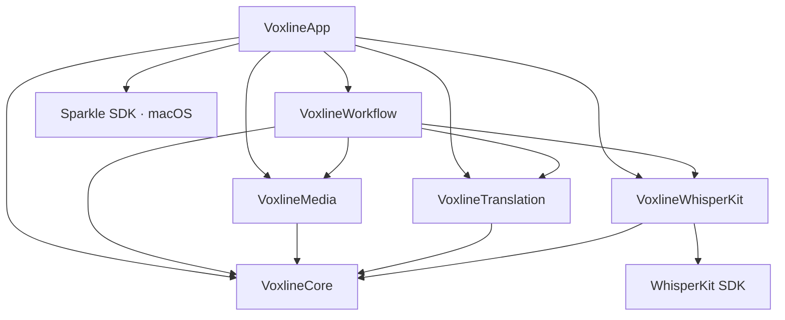

# 工程架构与设计边界

macOS 构建采用 SwiftPM，iOS 构建采用 Xcode 工程。两端依赖由根目录 `Package.swift` 与 `Package.resolved` 统一管理与版本锁定。

## 平台分层与代码组织

源码位于 `Sources/Voxline/`，划分为 6 个单一职责模块：

```
Sources/Voxline/
├── Core/               # 领域模型、状态机、SRT 编解码、断句切分
├── Media/              # 音频提取、播控时间线、暂停定位补偿、视频导出与封装
├── Translation/        # 离线翻译协调、OpenAI 兼容协议、云端转写协议、Keychain 凭据
├── WhisperKit/         # ModelManager 模型管理、WhisperKit 调度与硬件推理
├── Workflow/           # TaskLibrary 持久化、单执行者任务队列、检查点提交与同步
└── App/                # 跨平台 SwiftUI 页面、材质组件、窗口会话与交互绑定
```

### 依赖关系与架构边界

模块间遵循严格的单向无环依赖约束：



- **单向依赖控制**：底层模块（Core、Media、Translation、WhisperKit、Workflow）严禁反向导入上层 AppKit、UIKit 或 App 视图层。
- **Core 纯粹性**：`VoxlineCore` 仅依赖 Foundation 与系统基础类型，不引入音视频处理、Core ML、UI 框架或第三方库。
- **第三方 SDK 隔离**：WhisperKit SDK 仅由 `VoxlineWhisperKit` 模块导入并隔离，外部通过内部协议与模型交互，不直接暴露 SDK 数据结构。
- **并发与值类型语义**：核心领域实体（`ProcessingTask`、`SubtitleCue`、`TaskParameters`）均为 `Sendable` 纯值类型，支持在并发任务与 Actor 边界间安全传递。

## 模块职责划分

### VoxlineCore
- **领域实体**：定义根任务 `ProcessingTask`、媒体条目 `TaskMediaItem`、字幕行 `SubtitleCue` 与参数快照 `TaskParameters`。
- **执行检查点**：维护 `MediaProcessingCheckpoint`，记录分块转写与分批翻译的执行进度与诊断证据。
- **状态归结与校验**：媒体可用状态由字幕与翻译需求确定，执行状态由检查点统一归结。领域操作仅校验受影响记录，完整结构校验保留在文档编解码阶段。
- **SRT 编解码**：纯文本 SRT 解析器与生成器，支持原文、译文与双语三种导出投影。
- **自然断句切分**：`SubtitleSegmenter` 基于词级/段级时间戳、标点边界与时间窗口进行自然断句，避免短句切碎或跨句子黏连。

### VoxlineMedia
- **媒体检查与能力边界**：`MediaInspector` 读取容器格式、时长、多语言音轨信息，并基于头尾采样生成指纹。音频提取仅要求目标音轨可解码，非目标轨道错误不阻断主流程。
- **音频提取**：`AudioExtractor` 基于 `AVAssetReader` 提取目标音轨，生成 16 kHz 单声道 Float32 PCM，并以最大 120 秒分块落盘缓存。
- **播控与时间线检索**：`MediaPlaybackController` 封装 `AVPlayer`，提供 0.5x ~ 2.0x 变速回放与 ±5s 定位。基于二分法检索字幕时间轴，向界面分离发布活动字幕边界与高频播放时钟。
- **Mac 暂停精确定位补偿**：暂停定位时由独立 Actor 使用 `AVAssetReader` 解码前序同步样本至目标帧，渲染至 `AVPlayerView.contentOverlayView`，消除部分 H.264 视频在精准 Seek 后的画面残留，恢复播放时自动释放。
- **字幕导出与封装**：
  - `SubtitleBurnInExporter`：基于 Core Image 滤镜与 `AVAssetExportSession` 在 GPU 上逐帧渲染字幕，支持 H.264 与 HEVC 编码。
  - `SubtitleEmbeddingExporter`：基于 `AVAssetReader` 与 `AVAssetWriter` 将字幕写入独立 tx3g 轨道并封装为 MP4 容器，音视频样本直通不重编码。
  - `VideoExportDestination`：统一处理文件覆盖确认、临时路径写入与原子发布事务。

### VoxlineWhisperKit
- **模型生命周期**：`WhisperModelStore` 与 `ModelManager` 管理 Tiny、Base、Small、Large v3、Turbo 5 款模型的下载、SHA-256 完整性校验、沙盒存储占用统计与文件清理。
- **内存驻留控制**：单进程内仅复用一个已加载模型实例；模型切换时遵循“先释放后加载”策略；空闲时自动卸载以释放统一内存。
- **转写推理**：`WhisperKitTranscriptionProvider` 接收 120 秒以内的 PCM 数据切片，调度 Core ML 执行硬件加速推理，输出对齐时间戳与词级证据。

### VoxlineTranslation
- **Apple 本机翻译**：`AppleTranslationCoordinator` 调度系统级翻译会话，核验本地离线语言包可用性，支持无网络离线端侧翻译。
- **OpenAI 兼容翻译**：`OpenAICompatibleTranslationClient` 执行批量字幕翻译，维护双向滑动上下文窗口（前后各 2 句）保障对白语境连贯，支持自定义批大小与系统提示词。
- **云端转写协议**：`CloudTranscriptionProtocol` 适配 OpenAI Audio Transcriptions、Google Gemini 与阿里云百炼 Qwen 音频协议。
- **时间标注对齐**：针对 Gemini 等生成式服务提供的时间戳异常，回退至音频块时间区间承载正文，并保留原始响应用于诊断。
- **凭据安全隔离**：`KeychainTranslationCredentialVault` 将 API Key 安全加密存储于系统 Keychain，凭据绝不写入任务文档或同步存储。

### VoxlineWorkflow
- **任务持久化**：`TaskLibrary` 维护本地 `.voxline` 任务文档的读写与索引（`task-order.json`），管理关联媒体的安全书签与缓存清理。
- **执行队列调度**：`TaskProcessingQueue` 实现单执行者串行调度，管理音频提取、转写与翻译流程，统一负责取消信号传播、错误隔离与断点恢复。
- **转写与诊断边界**：通过 `TranscriptionEvidence` 统一转写结果抽象；证据由各提供商本地缓存，写入失败仅记录日志，不阻断任务主流程提交。
- **检查点原子落盘**：转写切片与翻译批次成果通过临时文件与原子替换方式落地，防止崩溃损坏文档。
- **iCloud 同步协同**：`TaskSyncCoordinator` 接入用户授权的 iCloud Drive 目录，通过 `NSFileCoordinator` 与 `NSFileVersion` 实现文件协同与冲突保护。

### VoxlineApp
- **跨平台界面构建**：SwiftUI 构建共享业务视图，通过平台特化代码适配 macOS 窗口/菜单系统与 iOS 导航/触摸交互。
- **交互状态管理**：字幕插入、校时、拆分与合并采用互斥弹窗路由；行悬停与高亮状态保留在局部组件内，避免触发全局重绘。
- **Mac 窗口会话隔离**：独立窗口维护专属导航栈与校对会话，页面切出时自动提交草稿；全局快捷键通过 Focus 路由至活动窗口。
- **系统材质与辅助功能**：macOS 26+ 采用原生 Liquid Glass 浮层，macOS 15+ 采用系统 Material；适配系统深色模式、VoiceOver 辅助标签、减少动态效果与减少透明度。
- **外观偏好事务**：外观与微染浓度调节在拖动过程中仅更新预览组件，松手后一次性提交应用偏好，避免高频持久化抖动。

## 执行模型与容错机制

### 任务持久化与并发保护

- **文档格式**：任务持久化为 `.voxline` JSON 文档（当前 Schema 版本 7）。
- **参数快照冻结**：任务启动瞬间冻结当前 `TaskParameters` 配置，后续全局偏好修改不污染正在运行的任务。任务在停止状态下允许显式变更模型与翻译参数；变更目标语言时需二次确认并重置译文状态。
- **原子替换提交**：`TaskLibrary.commitCheckpoint` 生成内存副本后通过文件系统原子操作替换原文件，提交失败保留界面草稿与错误诊断，确保磁盘文件结构完整。
- **人工编辑优先原则**：异步处理结果提交前校验字幕原文版本与人工编辑快照。若用户已手动修改该行字幕，迟到的翻译或转写结果放弃写入，保障人工修改不被覆盖。

### 串行队列与断点恢复

- **单执行者资源独占**：`TaskProcessingQueue` 保证同一时刻仅有一个媒体条目占用神经网络引擎与本地计算资源，避免多任务并发引发显存争抢与热降频。
- **阶段状态解耦**：音频提取、语音转写、文本翻译各自维护独立的检查点记录。单个条目失败仅标记当前项并捕获错误，队列自动继续处理后续条目。
- **断点续做机制**：应用重启或任务恢复后，执行引擎仅重试未完成的转写音频切片与缺失译文的字幕段，已落地检查点无条件复用。
- **边界异常修正**：词级时间戳失效时平滑降级至分析窗口的宏观时间段；切片末尾出现的零时长空白片段自动并入相邻有效字幕，保障导出合规。

## 资源组织与本地化

- **多语言资源**：简体中文与英文资源按模块组织于各子模块的 `Resources/*.lproj`。
- **类型安全本地化**：统一采用 `String(localized:bundle:)` 配合确定命名常量引用，确保编译器静态分析与字符串提取一致。
- **工程元数据**：版本号与构建号在根目录 `Version.xcconfig`（`MARKETING_VERSION` 与 `CURRENT_PROJECT_VERSION`）集中声明，macOS 与 iOS 目标工程自动同步。
