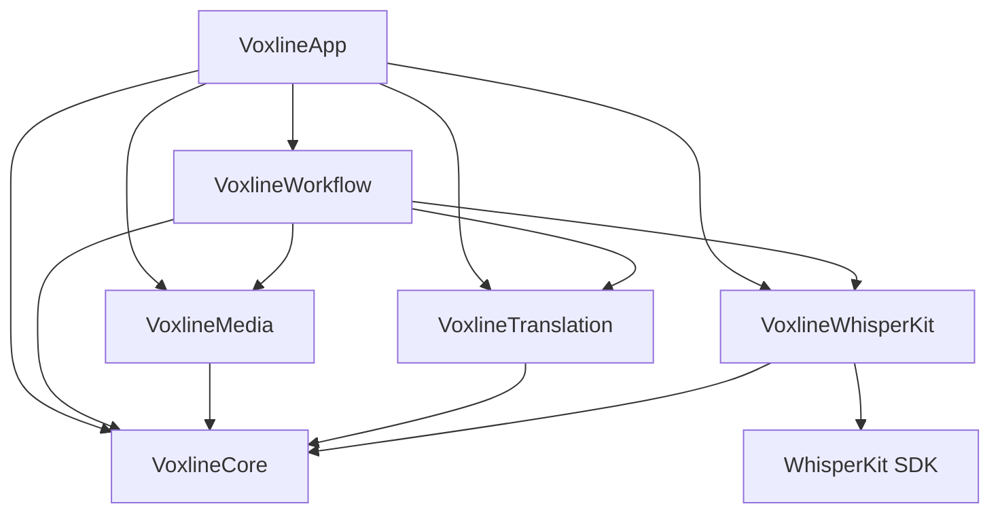

# 当前工程边界

Mac 采用 SwiftPM，iOS 采用 Xcode 工程。依赖提交由 Package.swift / Package.resolved 锁定，Mac 只链接 WhisperKit 产品。工具链、构建与产物统一见 [开发工作流](../development.md)。

两平台使用 Sources/Voxline/App 和同一 VoxlineApp 入口。平台原生适配放在 Platform/macOS、Platform/iOS，使用条件编译；任务状态、模型与翻译设置、参数编辑、原生材质组件在 Views 内共用。Apple 系统翻译接线在 Pipeline 内共用。iOS 通过原生导航进入模型管理、服务配置与语言准备，支持本地 Task 创建与媒体准备（复用 TaskConfigurationView 并适配原生触摸布局与安全作用域访问），通过同一原生流水线转写与顺序处理。导入成果的继续翻译、单句／全部／选中字幕重译和播放校对复用领域操作；SRT、任务和硬字幕视频通过原生分享交接。平台分支承担导航、触摸布局和原生文件 API。

iOS 的 Core、Media、WhisperKit、Translation 与 Workflow 框架直接编译同一份源码，WhisperKit 集成框架只链接固定版本的 WhisperKit 软件包产品。导入当前格式 .voxline / JSON 后验证并保存独立副本到本地 Documents。同任务 ID 再次导入须确认覆盖本地校对，原文件不写回，Mac 书签不传入 iOS。

## 模块职责

- VoxlineCore：ProcessingTask、参数快照、有序媒体条目、字幕版本、媒体身份、JSON 编解码、验证、转写协议、原始证据、字幕切分与检查点。阶段状态和文本、SRT 生成与导出也在此模块；SRT 文件写入使用调用方传入的 URL，不管理设备目录。只依赖 Foundation，不保存设备路径、书签或密钥。
- VoxlineWhisperKit：共用多模型清单、下载与安装检查、本地占用、实例生命周期、有界输入 Provider 和 ModelManager 的可观察状态。SDK 类型只存在于该模块；应用接收真实下载、加载和推理状态。同一进程复用唯一已加载实例；删除或重新下载已加载模型时自动卸载内存挂载，收敛交互状态。
- VoxlineMedia：AVFoundation 原生能力检查、有界采样指纹、设备本地书签、有界 PCM 提取、按已完成范围裁切的音频切片和共用播放器。字幕烧录的快照、合成、预览与导出在此模块，Mac 与 iOS 共享原生 Core Image 与 AVAssetExportSession 烧录服务。AVFoundation 类型不进入 Core 或 Task 文件。
- VoxlineTranslation：聊天／Audio Transcriptions 客户端、上下文批次、结果校验、HTTP 错误、设备服务元数据和异步 Keychain 凭据。依赖 Foundation、Observation、Security 与 Core，不依赖应用、SwiftUI 或 AVFoundation。PCM 读取与上传静音补齐由 Media 提供，Workflow 注入协议执行所需的音频处理闭包。
- VoxlineWorkflow：TaskLibrary、单执行者 TaskProcessingQueue 与媒体／翻译外部调用边界。依赖 Core、Media、WhisperKit、Translation；组织实际操作、恢复与原子成果提交，不导入 AppKit、SwiftUI 或应用模块。翻译执行实例由应用接线传入。
- VoxlineApp：两平台入口、主要页面、导航与原生适配。MacWorkflow 配置任务目录与系统最近文档；翻译引擎接线和 Apple Translation 视图会话共用，视图会话保持在稳定根页面。iOS 设备副本库适配同一 TaskLibrary 和 TaskProcessingQueue，通过同一 ConfiguredMediaTranscriptionPipeline 执行本地媒体处理；已有完整转写成果的继续翻译保持独立入口与来源检查。UI 不导入第三方 WhisperKit SDK。

Core 和字幕文档不依赖 UI、AVFoundation 或具体推理 SDK。JSON 是持久字幕权威来源，SRT 是导出物，内存任务库是界面状态。

模块依赖如下；Mac 使用 SwiftPM，iOS 使用同源码框架及固定软件包产品。

底层模块不得反向引用应用。测试直接依赖被测模块；应用接线中的协议映射由应用测试覆盖，页面交互和系统视图会话须在目标平台验收。选择理由见 [ADR-0016](../ADR/0016-workflow-and-capability-ownership.md)。

## 界面本地化

简体中文和英文资源按模块归属维护于各自 Resources/*.lproj，页面、菜单、辅助功能标签、应用错误和动态状态使用 Foundation 原生 String(localized:bundle:)。资源在 SwiftPM 模块包或 Xcode 框架中读取；Mac 签名包将模块资源放入 Contents/Resources，缺少资源明确失败，不回读开发目录。默认遵循系统和应用语言选择，不维护全局语言服务或持久语言映射。动态参数保留编译器确定的格式类型，字幕数量采用原生复数资源；数字与日期使用系统区域格式。

枚举身份、任务数据、服务配置、字幕和系统提示词保持独立，语言只影响显示及新建默认名称。服务和系统返回的原始错误保持原内容。模型清单由 WhisperKit 集成模块提供，两平台共用；显示文案读取实际模块资源包。

## Task 持久化

Mac 新任务保存至应用本地 Application Support/Voxline/Tasks；导入已有文件后保存到原 URL，不保留额外副本。Workflow 的 TaskLibrary 由调用方传入目录，系统最近文档通过 Mac 接线提供；登记不写文件，保存先编码验证，再原子写入，成功后更新任务库。条目只能由任务库发布。两平台的媒体编辑共用 updateItem，对照最新媒体快照后保存；读写或目录错误明确显示，损坏任务保留错误条目，保存失败保留界面草稿与最后成功写入的成果。iOS 设备副本规则见“iOS 本地播放与校对”。

版本 7 的 .voxline 根对象为 ProcessingTask。当前本地开发阶段只读写此格式，旧格式明确拒绝，不维护迁移分支。任务不保存导出类型或校对确认标记；媒体指纹为文件大小及头尾采样。运行媒体及内部转写块／翻译批次转换为 interrupted，保留已提交成果。

Task 保存一份参数，有序媒体条目分别保存来源、身份、字幕与状态。整体状态和统计从条目计算。首次开始要求至少一个可处理媒体，已失败或取消的输入不阻塞其余合法条目。recordStart 记录首次开始时间；执行者在每次启动时取得当前任务参数快照，不调用 Provider 或生成成果。

格式、ID、字幕结构和失败原因在编码前与读取后验证；恢复所需原始段与未完成识别证据保持原值，切分只在新识别提交或显式恢复时执行。损坏、未来版本或非法数据抛出错误，不创建空 Task 替代原文件。

停止执行后可显式修改转写方式、服务、模型、原文语言及翻译参数。参数保存保留全部已有字幕、人工译文和历史识别来源，不自动重新转写。ProcessingTask.updateParameters 同步更新检查点参数，翻译设置变化移除旧批次，保留原文、时间、完成来源、未完成转写证据和已有同目标译文。目标语言变化且已有译文时必须明确确认，再将旧译文置为待翻译；完整转写的媒体根据已有译文转为完成或待翻译。执行者仍占用任务时拒绝保存，草稿提交对照当前 Task。选择理由见 [ADR-0017](../ADR/0017-explicit-task-parameter-edits.md)。

TaskLibrary 的 task-order.json 保存本设备任务列表的稳定条目 ID 顺序，合法任务使用 Task ID，损坏文档使用文件 URL；同步迁移不改变任务排序身份，独立于成果文档；拖拽先原子写入顺序，成功后发布。登记已有任务与检查点保存保持现有位置。删除前界面展示实际文件和成果影响；文档去重使用规范路径，实际读取保留原始 security-scoped URL。删除先核对已知活动文档和副本引用，再移除目标文档、排序及最近文档记录，最后按媒体 ID 清理未共享的本地关联、PCM 和转写缓存。缓存损坏或清理失败不阻止文档删除，具体失败路径显示为独立清理错误。其他任务无法读取时保留缓存并显示原因；未知历史平铺证据不解码、不猜测归属。原媒体、其他副本、导出物、模型、服务和密钥保留。正在执行的任务不能删除；排列顺序不自动启动任务。选择理由见 [ADR-0018](../ADR/0018-task-resource-cleanup.md)。

长期决定见 [ADR-0005](../ADR/0005-task-document-format.md) 与 [ADR-0006](../ADR/0006-single-window-task-library.md)。

## 处理检查点与恢复

MediaProcessingCheckpoint 属于单媒体条目，绑定媒体内容、所选音轨与冻结参数，保存有序转写块和翻译批次。恢复计划必须匹配重新检查的媒体、参数和实际提取范围列表；不匹配明确要求重跑或新建 Task。范围使用提取器声明的整数毫秒，最多 120 秒；相邻范围允许一毫秒的 PCM 量化交集，字幕时间仍须严格有序。

转写块区分 pending、running、interrupted、completed、failed、cancelled。每次实际开始分配新的 sourceID，完成结果必须属于该次运行且符合原范围和转写设置，迟到结果拒绝提交。成功块只保存块 ID、范围和 TranscriptionCompletion.sourceID，字幕提交到媒体 cues；原始段、词时间、解码窗口、切分初稿及重复云响应不进入完成记录，完整证据由 Provider 保存在设备缓存。失败／取消仍在 Task 保存全部可用恢复证据，包括 windows、词元和 cloudResult，缓存清理不迫使重新识别。异常浮点值以 NaN／+Infinity／-Infinity 字符串保留，NaN 诊断数据的等值比较不会把未改动快照判断为编辑。成功块不会再次加入字幕，也不能用不同来源替换。

媒体的 cues 是唯一的持久文本成果，不与机器初稿的 ID 集合绑定。正常顺序提交直接追加字幕；补交更早失败块时才按开始时间重排当前时间线，保留已编辑字幕及其 ID；重叠仍明确失败，不裁剪已有成果。新转写提交核对完整原文覆盖和当前字幕时间线，保存与加载不重新执行切分算法。未完成批次输入核对自身结构，不要求仍存在于当前字幕中；一次检查点验证只计算一次转写完成事实，供全部翻译批次共用。Task 采用保留排序键的紧凑全量 JSON 和原子保存；读取原有完成快照时只解码来源与完成状态，不解码已废弃的证据、初稿及批次文本。未完成证据、字幕和 ID 保持原值；完成块跳过执行，不依赖设备缓存，不重切分机器初稿。

转写全部提交后才能建立翻译批次。未完成批次保存字幕 ID、原文、原文版本与已有译文快照；结果必须完整匹配 ID 且译文非空。批量准备一次计算恢复与占用集合，执行期间复用 TranslationCheckpointIndex 的字幕与批次位置，开始批次直接返回当前输入；结构编辑改变位置时按当前 ID 重新定位，文本与已有译文仍按当前快照核对。提交只核对本批输入与结果，待处理批次在实际开始时核对，失败／取消／中断批次继续保留其有效失败状态，不在每次提交后扫描全部待处理输入或重复验证完整条目；完整文档在保存与加载边界验证。重复字幕 ID 明确报错。所有输入仍与当前校对内容一致时才整体提交；删除、拆分、合并或文本修改后的迟到结果拒绝覆盖，历史批次仍可读取。时间编辑不使相同原文的翻译失效。后续批次仍可执行时保持翻译阶段运行，进程重开显示翻译中断，不在每批之间退回等待。完成批次只保留批次 ID 和完成状态，输入及输出文本不重复持久化；原文更新后保留已有译文，版本只用于请求快照和编辑保护，不作为完成或导出门槛。

MediaRecoveryPlan 只列出未完成转写块、可复用的未完成翻译批次、过期批次及尚无译文的字幕。成功块／批次跳过；过期批次不能用旧输入继续，当前原文建立新批次。failed／cancelled 范围可在明确恢复或重试时使用计划，不自动启动执行。已知失败、取消或中断不会被其他块／批次的成功掩盖；媒体完成要求全部块提交，并在启用翻译时拥有全部有效译文。

TaskLibrary.commitCheckpoint 在主线程取得最新任务，修改副本、验证并原子写入唯一任务文件，写入成功后才发布结果。界面读取任务库发布的任务，编辑保留独立草稿；参数、字幕、时间偏移和媒体关联均在保存成功后发布，失败显示原因并保留草稿和重试入口。处理结果只读取已发布的最新编辑，草稿提交继续对照当前成果防止覆盖。读写失败不发布新完成状态，也不覆盖最后成功文件。检查点不引用模型、PCM 或诊断缓存路径，缓存清理不影响已提交成果。参数与成果重置入口由明确重跑流程提供，已有字幕不会被初始化检查点覆盖。

共享目录展示器使用串行后台 OperationQueue，变化 URL 转交应用线程后与元数据通知按 300 毫秒窗口合并；目录级通知只扫描共享目录元信息，以修改时间、大小、下载与冲突状态判定需重读的任务。页面显式刷新后台枚举目录、读取本地／最近文档及解码，共享任务复用原生异步协调读取；已打开的本地任务直接使用内存成果。新增、删除、下载就绪及损坏文件仍有明确状态。目录枚举、系统文件状态读取、协调读取和文档解码在后台进行，主线程只合并文件状态与任务库结果；无变化任务及本地／最近文档不随上传事件重复解码。执行中的任务保持当前快照，读取期间发生本地编辑、提交或同步目录切换时丢弃旧读取结果；本地未发布检查点仍优先于云文件。关闭或切换同步目录取消通知合并工作。初始化和同步迁移保持同步读取，以完成即时状态交接；保存仍按主线程中的最新任务顺序提交。

长期选择见 [ADR-0010](../ADR/0010-atomic-task-checkpoints.md)。

## 本地顺序执行

TaskProcessingQueue 在应用进程中只有一个执行者，按 Task 的媒体顺序运行。开始或继续时保存冻结参数和待处理状态，已完成媒体、没有检查点的已有字幕保持原成果。LocalMediaTranscriptionPipeline 复用 LocalMediaStore、AudioExtractor 与 WhisperModelStore；提取器验证实际内容、所选音轨和缓存，队列以真实提取范围匹配恢复计划，再逐块调用 Provider、切分并提交。本次稳定范围计划建立一次块 ID／位置索引，开始、完成和失败提交复用位置并核对当前块 ID；成功块跳过，失败块保留证据，其他块和媒体继续。

任务级取消先停止后续调度并取消当前实际操作，再保存等待项的取消状态；保存失败保留明确错误并继续停止执行，不假定取消状态已写入。单项取消可以跳过等待项，或取消当前实际操作后继续其他媒体。取消期间占用执行者，直到实际提取或推理返回才允许重试。返回但未提交的原始证据保存为取消记录。提取及转写回调只更新当前操作的显示进度，阶段与完成状态由实际操作和检查点提交驱动。执行结束清空当前执行状态后通知应用释放平台资源。

媒体、范围或手工校时冲突保存为该项失败，原始证据与编辑保留；保存错误停止后续调度，界面明确显示原因。当前运行转为中断；中断状态也无法保存时仅登记内存并明确提示，最后成功文件保持原值。修复文件写入后可继续，或重新打开已保存文件恢复。页面提供开始／继续、任务和单项取消、单项重试及详情校对入口。

启用翻译时，转写全部提交后建立或复用持久翻译批次，完成媒体要求全部有效译文已提交。批次失败停止该媒体的翻译并继续其他媒体，明确重试才重新请求；成功块与批次跳过，过期批次使用当前内容重建。恢复时已完成转写的媒体直接进入翻译，不重复检查或提取音频；仍需转写时保留原生媒体恢复检查。网络请求取消后等待实际操作返回，迟到响应不提交。MediaTranscriptionPipeline 与 SubtitleTranslationPipeline 划定外部调用边界；转写调用显式传入媒体 ID，Provider 将独立证据保存至设备缓存 Transcription/<媒体 ID>/，不从输入路径推断归属。旧的平铺证据不再参与任务删除；当前证据按媒体 ID 清理。可控执行仅用于测试，产品实例调用原生媒体、WhisperKit，以及冻结参数指定的实际聊天接口或 Apple Translation。

Core 按媒体检查点推导阶段事实，界面只负责显示：后续翻译失败或取消时，已经完成的音频提取和转写保持完成；尚未开始的翻译保持等待。中断的当前阶段显示暂停，不显示正在执行的进度动画。

## 字幕聊天翻译

Task 冻结服务 ID、地址、模型和目标语言；执行时按服务 ID 取得本地凭据，服务地址与快照不同明确拒绝，不静默切换目的地。聊天协议参照 [OpenAI Chat Completions](https://developers.openai.com/api/reference/resources/chat/subresources/completions/methods/create)，仅发送字幕文本，不发送音频。参数与成果不包含 API 密钥。

每批数量使用任务冻结参数，具体规则见下文“翻译数量与提示词”。序列化的 UTF-8 输入最多 12,000 字节，包括前后各两句上下文。此容量是输入字节上限，不推算服务的模型上下文或费用。过长单句与上下文明确失败，不截断原文。分批在单次操作中建立字幕 ID／位置索引，复用上下文位置；每句 id／text 对象仅序列化一次，以相同空协议包、本次操作按需缓存的对象长度和数组逗号计算候选批次的实际 JSON 字节容量，包含转义字符和上下文。执行者构建请求和重试复用检查点位置索引，并核对当前字幕快照；客户端仍在发送前检查真实完整请求的容量。相邻上下文与本批字幕分别发送，只翻译目标 ID；不依赖兼容服务未必支持的 JSON Schema 参数，提示要求 JSON，解析允许单个完整代码围栏外的说明文字和结果中的额外字段；未闭合或多个围栏明确失败，完整核对目标 ID 与非空译文。

响应要求单一完整 assistant 消息、finish_reason 为 stop，以及唯一 translations 数组。响应可带完整 Markdown JSON 围栏和附加字段；只提取 translations 内的 id 和 text，完整匹配本批 UUID，拒绝缺项、重复或额外 ID、空译文和未完成响应。结果通过检查点中的原文版本及已有译文验证后整体提交，模型和目标语言由对应检查点参数保留。失败不以原文填充译文。

429、408、500、502、503、504 和超时允许最多三次自动重试。有效 Retry-After 优先采用秒数或 HTTP 日期；缺失或无效时按 5／15／45 秒退避并增加最多 20% 随机等待。队列显示当前阶段、已完成比例、倒计时、尝试次数及最后错误；等待可立即取消，退出后按中断批次显式恢复，不在重启时自动启动。鉴权、无效参数、其他 HTTP 状态、连接失败及响应校验错误明确失败，不自动重试。重试前核对原文与已有译文快照，编辑后停止请求并保留编辑；提交仍执行同一检查点校验。

临时错误的三次重试耗尽后，批次保存失败原因，媒体保存 translationPaused，任务显示翻译暂停，后续媒体继续。重新读取保持暂停；“继续翻译”复用冻结参数和未完成批次，跳过成功转写及翻译。暂停要求启用翻译、全部转写已提交且存在失败翻译批次，不计为完成；原生播放、校对与原文导出仍可用。引擎选择与暂停状态按当前 Task 格式保存。

不自动拆小失败批次或切换模型。网络错误不输出请求头、密钥或上游原始响应正文。服务连通不代替字幕质量验收，实际验证结果统一维护于 Project。

## 本地服务与凭据

TranslationServices.json 保存服务 ID、名称、地址、默认模型及下文“翻译数量与提示词”的参数。密钥由异步 KeychainTranslationCredentialVault 按服务 ID 存入设备本机 generic password；阻塞的系统调用在独立 actor 上执行，不在主线程读取。加载配置只查询凭据条目是否存在，编辑或实际请求时才读取密钥。Mac 开发构建使用固定证书和 Bundle ID 保持签名身份；切换签名身份可能需要一次读取授权，构建规则见 [开发工作流](../development.md)。不更改钥匙串访问控制。不同步到 iCloud，不进入 Task、导出物或日志。任务调用冻结模型，不因服务默认模型修改而改变；地址与快照不同明确拒绝。

旧明文配置按原 ID 写入 Keychain，全部写入成功后才原子删除 JSON 中的密钥字段；中途失败保持旧文件，重试迁移不产生新 ID。缺失文件表示未配置，损坏文件、钥匙串拒绝及写入失败明确显示，不创建默认服务替代错误配置。读取失败保留最近已读的内存配置，但禁止发起任务请求，直到成功重读或保存有效配置。

保存或删除服务时先更新凭据、再原子提交元数据，失败恢复旧凭据，成功后才发布服务列表。旧凭据恢复失败也明确显示并禁止任务调用。读取或保存期间不并发改写配置；编辑页待读取密钥结束，读取失败且没有明确新密钥时不能把空编辑值覆盖旧值。

配置页、编辑页及任务执行共用同一聊天客户端。连接测试发送一条短文本并调用选定模型，验证实际聊天与 JSON 协议，不以 models 列表成功冒充翻译可用。界面明确说明字幕文本发送到所选服务、音频保持本地；空密钥明确采用无鉴权请求，仅适用于无需密钥的服务，服务要求鉴权时返回具体错误。不重复授权每个媒体，不估算没有可靠依据的费用。选择理由见 [ADR-0011](../ADR/0011-local-translation-credentials.md)。

## 输入与文件访问

任务导入与重新关联使用 SwiftUI 原生 fileImporter，由所在页面呈现文件选择器，不依赖 NSApp.keyWindow 或应用是否处于前台。

TaskConfigurationView 以具体 Task 对象驱动 sheet，在独立草稿上多选 MP4/MOV/M4V、M4A/MP3/WAV，逐项展示能力、失败原因和音轨。多语言音轨必须选择；单音轨可直接选定。错误输入与合法条目共同提交，书签确认失败的新增条目标记失败并保持未关联，便于修复。已有媒体字幕保持原值。

MediaInspector.shared 在进程内复用相同 URL、文件大小与修改时间的检查结果，每次仍打开文件验证实际权限。文件元信息变化后重新读取最多 1 MiB 文件头与 1 MiB 文件尾，以 SHA-256 计算采样指纹；大小、采样指纹、时长和音轨用于检查点恢复及缓存匹配，不作为重新关联的门槛。明确选择新的可解码媒体后更新本地书签及当前身份，保留字幕、译文与原始识别证据。未完成识别仍绑定原输入；已完成识别可直接继续翻译，不重新提取音频。新进程首次访问重新检查，不把设备媒体索引写入 Task。缓存不检测大小和修改时间同时保持不变的内容改写。

LocalMediaStore 保持只读沙盒书签，缺失、损坏、授权失败和内容不符均明确处理。播放前验证身份，过期书签经验证后更新；播放期间持有访问，关闭详情释放访问与观察器。详情加载跟踪媒体条目 ID、内容身份及所选音轨，远端改变关联时重新加载播放器；纯字幕编辑不触发重新加载。同一身份的设备本地重新关联仍通过面板完成回调刷新授权。原生预览只加入用户选择的音轨，保留源轨道时间和视频变换。Mac 视频画面通过 NSViewRepresentable 承载原生 AVPlayerView，避开 macOS 15 上 VideoPlayer 的框架元数据崩溃；原生控制与字幕浮层仍共用播放器。AVPlayerItem 确认可播放后才启用控制，原生与自定义控件共享 AVPlayer 状态和时间轴；结束及播放中断显式更新。释放或切换媒体后，旧加载、定位和观察回调不能更新新页面。

字幕预览采用开始包含、结束不包含的时间区间，连续字幕在边界切换到下一句。MediaPlaybackController 对有序时间线做二分定位，分别发布播放时钟、当前字幕与最后已播字幕终点；播放控件观察时钟，详情浮层和字幕列表只观察字幕边界变化，不能让逐帧时钟触发整页字幕扫描与重建。字幕修改后更新播放器时间线，不重新加载媒体。Mac 悬停状态只属于对应字幕行；两平台手动滚动与惯性滚动期间不启动自动跟随动画，空闲后的字幕切换恢复跟随，减少动态效果时不使用滚动动画。译文缺失／失败明确展示状态，已有译文可继续使用。整体偏移先验证全部时间、溢出和媒体边界，再一次替换 cues，保留原文、译文及版本；非法偏移不能产生部分修改。

SubtitleEditing 的增删、逐条校时、拆分与合并操作只修改当前字幕，提交前检查当前快照、完整时间顺序与媒体范围。拆分和合并为受影响字幕生成新 ID，不影响其他字幕；译文由此次编辑明确提供。ProofreadingSession 在两端管理草稿、搜索、选择及最近一次成功编辑的撤销；字幕快照或搜索条件改变时才更新列表，同一次保存再次经视图观察收到时不重建；翻译缺失状态随字幕更新计算，播放刷新只读取结果；字幕行只接收本句及原时间线的下一句，不携带完整媒体条目或重复查找相邻句。本地保存成功后才结束草稿并记录撤销，保存失败保留草稿。撤销只恢复字幕时间线，保留最新执行检查点；后续字幕已改变时拒绝旧撤销。平台视图负责播放布局和错误呈现。

Views/Task 中的 ProofreadingPlayerControls、ProofreadingCueRow 和 SubtitleStructureSheets 共享播放控件、字幕行和结构编辑接线；Views/Sheets/SubtitleStructureEditor 只承载四种编辑表单。新增字幕请求在打开时生成一次身份，关闭前保持稳定；播放刷新不能重建表单草稿。字幕行的编辑状态由 ProofreadingSession 草稿推导，平台入口不再复制一份编辑状态。

硬字幕面板共用 SubtitleBurnInSession，冻结媒体及字幕，统一合成计划、CGImage 预览、进度、取消与资源释放。Mac 提供目录／覆盖选择和 Finder，iOS 提供临时输出、分享和视频预览；两端使用同一 VoxlineMedia 导出能力。字幕在实际视频绘制回调中按当前句排版并缓存当前叠加图，不提前遍历整片再重复排版；真实排版或绘制失败由合成回调传播，导出清理临时文件并保留已有成品。

任务准备等待期间保护原 Task 快照，实际发生修改时拒绝覆盖。取消停止未提交工作。文件访问和恢复只处理实际需求，不加入账户角色、执行租约或云冲突框架。

## 音频提取

AudioExtractor 按媒体条目 ID、内容身份和实际所选音轨管理本地 Caches/Voxline/Audio。读取复用 MediaInspector 的检查，源文件在检查或提取期间变化时明确失败。

AVAssetReader 只读取所选轨道，从第一个非空轨道段开始。输出为 16 kHz、单声道 Float32 PCM，复用一秒写缓冲，按最多 120 秒分块落盘；不把整段音频载入数组。每块记录源时间帧与实际帧数，转为 TranscriptionAudio 时保存绝对毫秒起点，时长向上覆盖不足一毫秒的尾帧。

源时间的前置空段保持起始偏移；系统解码出的内部静音保留；实际时间间隙开始新块，回退明确失败。允许一个输出采样帧的时间量化误差，不排序或消除时间间隙。提取范围取所选音轨与源媒体有效范围的交集，保留解码后的所有范围内 PCM 帧；解码器返回的最后完整编码包超过媒体终点时，只写入终点以内的帧，终点采用原生 CMTime 并向下换算到 16 kHz 帧。范围外数据不进入缓存或转写；其他时间回退与异常继续失败。

完整解码、源文件检查和结果验证通过后原子写入 audio.json；取消或失败不提交缓存记录。复用前检查内容身份、版本、每块时间与 PCM 文件格式和帧数。缺失、不完整或明确损坏的派生 WAV 发出失效原因并重新提取；仅识别音频文件格式、数据、块结构及 EOF 错误，权限、取消、未知读取错误和源媒体解码或写入错误继续传播。缓存仅在设备本地，不进入 Task 文档。

## 转写 Provider

WhisperKitTranscriptionProvider 固定使用 Task 参数中的模型与语言，未知型号或语言代码明确拒绝。输入为 VXL-008 生成的最多 120 秒、16 kHz 单声道 Float32 PCM，实际帧数必须匹配声明时长。每次只读取一个有界音频块，使用一秒缓冲循环读取全部帧，单次短读不视为 EOF；读取后复用 WhisperModelStore 的唯一模型和单 worker。下载、加载或推理期间，其他模型修改明确返回忙碌错误。

推理直接使用 SDK 音频数组入口及 none 策略，不进入增量读取器、VAD 并发分块及可能跳过失败的合并路径。SDK 内部仍按模型窗口顺序解码；末尾 seek 小于 20 毫秒时不重复发起解码，同时验证实际窗口已覆盖全部输入，防止浮点取整产生仅一帧的重复窗口。不足 20 毫秒的独立输入不能冒充已转写。局部重转写需要先提取目标音频范围并提供正确源偏移，当前 Provider 不接受可被忽略的 SDK 范围参数；Task 范围提取与重转写入口另行接入。

TranscriptionEvidenceSeeker 在 SDK 过滤前记录每个窗口的原始文本、词元、实际帧范围、语言、静音判定及对齐前后段。DTW 输入仅保留真实音频对应的 20 毫秒列。对齐矩阵保留 Float16／Float32／Double 原类型及逻辑行跨度，不限制为单一型号的 Float16。WordTimestampAligner 按矩阵逻辑行列读取权重，保持固定 SDK 的 DTW 路径与平局规则，复用其词时长限制和段更新时间；避开 SDK 向带行填充的 IOSurface 按连续行复制权重造成的时间错位。词元、原文、源偏移和真实输入范围保持原值。对齐后出现非空零时长段、时间回退／重叠、窗口越界或词文本与原始段不一致时，整个窗口回退到对齐前的段解码时间并去除词时间，窗口记录 usesSegmentTimings，对齐后结果保留为诊断证据；段解码时间包含模型补齐窗口的尾部时，与实际音频窗口取交集；裁剪后仍无有效时长或存在明显回退／重叠才返回失败。只回退整个窗口，避免段时间与相邻对齐段重叠。失败块中最后一窗时间校验失败但覆盖完整的本地识别也可复用，恢复时重新选择时间并切分，不再调用模型；部分解码、缺失窗口或改变原文仍失败。完成块、人工编辑和异常对齐证据保持。置信度异常、覆盖缺失或 SDK 遗漏非空文本始终返回失败，不能被时间回退掩盖；不自动重识别或宣告字幕质量通过。

RawTranscriptionSegment 与词时间都使用源媒体绝对秒数；原始窗口时间保持原值；使用段时间时按真实窗口边界裁剪派生时间，不排序或消除重复文本。缺失词级信息用 nil 表示，不按字符插值。空文本和静音判定保留在原始记录，字幕切分独立决定其展示规则。

自动语言在每块首个模型窗口显式检测；检测失败或未知代码直接失败，再以确定的代码转写该块，避开 SDK 转写循环的默认语言路径。读取、模型加载、语言检测和解码词元进度来自实际工作，推理错误或协作取消传播为 TranscriptionFailure；失败包含完整输入范围、已收集窗口、尚未提交窗口的解码文本／词元及取消状态。诊断证据以原子 JSON 保存于本地 Caches/Voxline/Transcription，写入失败同时保留内存证据和存储错误。成功只在证据写入后发布；缓存不作为 Task 持久成果，队列通过处理检查点独立提交。异常浮点值以明确字符串保存，不修正成有效时间。

选择与理由见 [ADR-0008](../ADR/0008-bounded-transcription-evidence.md)。

## 可读字幕切分

SubtitleSegmenter 只接受 completed 且无失败原因、未提交文本／词元的 TranscriptionEvidence。段和词保持原顺序；原始段开始落在输入内但结束超过输入末端时，生成字幕的结束时间裁到末端，原证据不变，不以固定误差阈值拒绝整块台词。相邻段起点最多 50 毫秒的量化误差钳制到前段末端；明显重叠、完全位于输入外或裁剪后零时长仍明确失败。非空零时长段、词文本遗漏、不合法毫秒时间或越界明确失败，调用者保留原证据并重新识别或人工校时。失败或取消范围不能产生完成字幕，成功块可独立保留；人工校时与局部重识别的执行入口随校对和恢复接入。

每个原始段内部按 SDK 词时间聚合，结合句末标点、停顿标点回溯、静音间隔、最大显示时长与文本宽度切分。英文连续词片段和独立标点保持相连；常见称谓缩写不作为句末。默认宽度 40 列、最长 8 秒、最短 1 秒、静音切分 500 毫秒。宽度按字素计数，CJK／全角与常见表情计两列，其余一列，是文本预算而非字体像素测量。原始段之间保持边界，不合并重叠或重复文本。

词文本与段文本在 Unicode 标准化、忽略空白后必须一致；切分保留词文本，只去除每条首尾空白。空原文仅在其词列表也无非空文本时排除，记录原始段索引。零时长词随有效对白保留；切分到与前句末端相同时间的零时长尾词时，将尾词留在前句，不能独立构造无效字幕。缺失或空词列表时保留完整段文本与实际段时间，alignment 标记 segment、记录 missingWordTiming；不按字符比例估算内部时间。时间来源及异常对齐留在识别证据中，不生成强制校对标记。整词或整段无法满足限制时记录 exceedsWidth／exceedsDuration，供校对处理。

短字幕只向右延长到下一条真实对白起点或当前输入块尾，未达到最短时长时记录 shortDisplay。源段与词时间不修改；延长不覆盖后续对白，也不跨入尚未识别的下一个输入块。

SubtitleSegmentationResult 保存输入证据、策略、字幕及段／词范围来源。sourceID 标识不可变的转写结果，字幕 ID 由该 ID 与原始段及首词位置确定；相同输入和策略重复切分、保存后读取均保持 ID。重新识别使用新的 sourceID；调整策略可能改变边界，不能借 ID 相同自动覆盖手工编辑或复用过期翻译。成功结果验证后将字幕与来源摘要一起提交到 Task 文档，完整切分结果不作为第二份持久字幕。

选择与理由见 [ADR-0009](../ADR/0009-readable-subtitle-segmentation.md)。

## 执行与界面

MainWindowView 组织任务列表、准备表单、任务详情和媒体详情。NativeControlSurface 在系统 26 及以上使用原生 Liquid Glass，旧系统使用 Material；原生组件优先。系统 26 视觉和辅助功能设置的运行验收由 VXL-049 跟踪（暂缓）。

iOS 任务列表通过 ForEach.onMove 接入原生长按排序，无需切换编辑模式；移动可读任务时保持无法读取的文档位置，调用 TaskLibrary.reorder 原子保存后发布。Mac 任务卡片保留拖拽与点击，显式提供原生激活焦点、空格／回车和辅助功能按钮操作；损坏任务不提供打开操作。

减少透明度时，自定义控制与字幕浮层使用不透明背景。减少动态效果时，字幕切换取消淡入淡出，当前行与悬停状态即时更新；原生控件沿用系统辅助功能行为。

单句重译直接替换该句译文，批量重译使用简短原生确认；补全无译文与普通继续翻译保留已有译文。两平台共用持久批次和翻译参数，取消等待实际请求结束，提交前检查发送时原文版本与译文快照。

校对是可选编辑。转写与所需翻译全部提交后直接完成，不要求逐句或一键确认。编辑原文保留已有译文，内部修订用于阻止迟到结果覆盖编辑，不展示失效或待重译状态。已有失败、取消或中断不被一次编辑宣告完成。字幕和参数草稿先保存再发布，失败保留草稿与最后成功成果。

禁止计时模拟进度、示例字幕或伪译文。模型具有安装记录且文件完整时才可用；SDK 加载状态留在内部，模型页统一展示已就绪。模型规则见 [ADR-0007](../ADR/0007-pinned-local-model-installation.md)。

原始 ASR 证据和可读字幕分开：RawTranscriptionSegment 保留原始对齐，转换为 SubtitleCue 前验证。切分及 Provider 不能排序、裁剪或丢弃文本来伪装成功。既有译文保留内部来源，新的自动处理不能覆盖请求发出后的手工编辑。

应用打包启用 App Sandbox、用户选择文件读写、应用范围书签和网络客户端。iCloud 使用用户选择文件夹与原生文件协调，云端转写使用设备服务和 Keychain；不配置应用专属 iCloud 容器。范围选择见 [ADR-0019](../ADR/0019-icloud-and-cloud-transcription-scope.md)。YouTube／Bilibili 来源后续实施；产品只支持 macOS 与 iOS。

## 模型安装与加载

WhisperModels 是两平台共用的型号、显示信息和上游提交清单，提供 Large v3（官方 large-v3_947MB 路径，32 层解码器）、Turbo（原有 v20240930_626MB 路径，4 层解码器）、多语言 Base、Small、Tiny。修正原先将 626 MB Turbo 命名为 Large v3 的错误，已有安装和任务型号 ID 保持。下载与 Provider 使用同一型号查询，不维护单模型白名单；型号的速度、内存和识别质量由实际设备与素材决定，不作为下载准入条件。

每个型号的 Application Support/Voxline/Models/<型号> 目录包含 SDK 缓存、权重、分词器和 installation.json。下载成功、取消检查和必需 Core ML／分词器文件存在后原子保存安装记录，记录文件相对路径与长度；刷新和加载只检查安装记录、文件存在与长度，不维护逐文件仓库摘要、不全量重读权重、不因上游提交更新拒绝已有安装。实际加载解析本地分词器并由 Core ML 加载权重，错误明确传播，不能把损坏模型当成可用推理实例。

WhisperModelStore 持有一个已加载 SDK 实例。相同型号复用，切换时先释放旧实例再加载新型号，避免同时驻留两套权重。转写按需调用；进程重启只识别安装状态。删除或重新下载已加载型号自动释放引用。未知型号明确拒绝，Task 参数页保留既有值，不自动替换模型或已有成果。

Store 通过有界 AsyncStream 发布实际下载、加载和推理占用，ModelManager 订阅并在闲置时刷新安装状态。占用期间禁用下载和删除，内存驻留不作为用户管理概念，底层拒绝并发修改。删除错误独立于安装状态保存，失败后重新读取实际文件与空间；页面提供重试删除，不转为重新下载。错误行只展示具体原因与对应操作。

下载进度来自 SDK 的文件完成比例，区分权重、分词器和文件检查。取消等待实际操作结束，操作标识隔离迟到回调。重新下载清理对应目录后完整下载；部分文件与缓存计入占用并可清理。网络、目录访问、空间不足、文件读写与加载错误显示实际原因，不使用固定磁盘余量门槛。决定理由见 [ADR-0007](../ADR/0007-pinned-local-model-installation.md)。

## SRT 导出

导出类型仅在导出时选择；字幕都有译文时默认双语，否则默认原文。文件名使用实际源媒体的基础名和 source／translation／bilingual 后缀，不从原文或目标语言猜测语言代码。全部字幕须通过唯一 ID、有序时间、非空正文验证；编辑提交与导出副本将起点仍在媒体内的字幕结束裁到媒体终点，正文不丢弃；起点在媒体外、零时长、重复 ID 或重叠仍失败；译文或双语必须每句都有非空译文，缺失或失败拒绝整个输出。双语顺序为原文在前、译文在后；换行统一 LF，移除正文中的空白行，避免被识别为新的 SRT 记录。

保存目录由原生文件选择器明确选择，在写入期间取得目录访问，使用 UTF-8 原子写入；已有文件须明确选择覆盖。导出成功显示实际文件名并保留窗口，可继续导出其他类型。校验和写入失败显示原因，既有目标文件保持最后成功内容。iOS 外部播放器兼容性须实际读取成品验证，文件格式检查不能代替播放器验收。

## Mac 字幕烧录

SubtitleBurnInExporter 复用 LocalMediaStore、MediaInspector 与 SRT 的时间与非空译文检查，读取所选音轨和首条视频轨，按源轨道时间与 preferredTransform 构造原生合成。输入为 SDR；检测到 HDR、PQ／HLG、BT.2020 或 P3 时明确拒绝，不作隐式色彩转换。

AVFoundation Core Image 滤镜对有序字幕二分定位，按 compositionTime 选择开始包含、结束不包含的字幕，先将无限范围的 sourceImage 裁切到 renderSize。Core Text 绘制居中白字、自动换行与深色背景，只缓存当前字幕图像；预览和导出共享同一个不可变字幕快照与视频合成。面板静态预览输出限制在 1280×720 内并保留比例与精确字幕时间；正式导出沿用源尺寸／最高 1080p 和编码预设。生成预览只排版当前句，导出按当前帧命中的字幕排版，复用当前字幕叠加图。预览取消停止原生图像生成；导出排版不重复执行整片预检。预览与导出共用自动换行及缩字，长文本完整适配画面可用区域，不因单句超长中止整片；无效画面尺寸明确失败。预设选择 H.264／HEVC 和源尺寸最高质量／最高 1080p，原生合成保留源帧时间与画面变换。

原生 audioMix 以单位音量处理所选音轨，避免 AAC 包直接复制缩短轨道尾部。导出后检查轨道可解码、所选编码、有效尺寸与显著时长异常，接受不足 0.5 秒的封装／重编码偏差，不对轨道端点作毫秒强等比较。

源访问保持到面板关闭。输出目录访问覆盖整个导出过程；先写同目录随机 partial.mp4，导出成功并核对编码、音轨、时长和尺寸后才发布。原视频及其硬链接不能作输出；已有输出需确认覆盖。取消停止原生导出，失败或取消移除临时文件，旧输出保留；临时文件清理失败单独明确显示。进度来自 AVAssetExportSession.states；只在发布成功后显示完成。iOS 观看验收读取实际成品，构建与帧解码不代替播放器验收。

选择理由见 [ADR-0012](../ADR/0012-native-subtitle-burn-in.md)。

## iOS 本地播放与校对

IOSTaskLibrary 为共享 TaskLibrary 提供设备副本入口，导入成果保存为 Documents/<Task ID>.voxline；相同 ID 覆盖前明确确认，正在处理的任务拒绝重新导入覆盖。任务与检查点只由共享任务库发布，不维护第二份结果数组。编辑在草稿中进行，写入前验证文档、媒体快照和字幕原文／译文版本，原子保存成功后才更新任务库。失败保留草稿并显示原因；取消不修改成果。设备副本可通过 Files 取得，导入源文件不写回。

iOS 使用进程内唯一设备任务库和队列；显式开始／继续处理，长按媒体重试或取消，任务控制显示实际进度、重试倒计时、队列停止原因与任务取消。进入后台通过 UIApplication.beginBackgroundTask 申请有限执行时间；未获许可或到期时停止队列，保存失败明确显示。每次保活有独立请求标识，迟到的到期回调不能取消后一次执行；队列结束或返回前台立即释放保活。有限执行时间不代表 BGContinuedProcessingTask 长任务能力，也不保证推理或系统翻译可在后台运行。取消后显式继续，进程结束后读取检查点中断状态，完成仍由实际成果提交决定。任务详情按概览指标、当前参数、媒体列表和处理控制组织；执行中禁止提交参数修改。媒体条目展示真实音轨、转写／翻译阶段状态与诊断原因；后续翻译暂停不破坏已完成的转写成果。

iOS 媒体详情的继续翻译要求任务启用翻译，且媒体拥有非空、全部完成的转写检查点；纯原文任务不显示继续翻译，提供显式配置翻译服务入口。单句／全部重译复用 TaskProcessingQueue.startRetranslation，交互沿用共用重译规则。参数编辑中的“管理翻译服务”携带原任务的冻结服务配置，尚未配置的服务可按原 ID、地址、模型和参数在本设备建立配置，密钥另行输入；恢复设备配置不写回任务。选择已有本机服务在参数草稿中进行，明确保存后更新任务的服务 ID、地址和模型，保留目标语言、数量、提示词及已有译文；取消草稿不改任务。密钥仍按本设备所选服务 ID 读取，不复制到任务。修改默认值不改变任务快照。

OpenAI 兼容接口支持显式配置的 HTTPS 与 HTTP 地址，包括本地服务。iOS 声明对应网络传输配置及本地网络用途；访问本地服务时由系统管理网络许可，拒绝或请求失败显示实际错误。

媒体通过原生 Files 选择，MediaInspector 检查实际内容与音轨。检查失败保留原因并提供重新选择；读取、文件变化或取消后可明确重试检查，格式、内容或解码能力不支持时须重新选择文件。重新关联允许新的可解码媒体及明确音轨，保留已有字幕和原始证据。媒体保持文件引用，iOS 使用 minimalBookmark 保存设备本地授权，Mac 继续使用只读 security-scoped bookmark。播放共用 MediaPlaybackController，缺失授权或内容变化显示重新关联入口；保存关联期间保持访问并禁止关闭面板。

AVKit VideoPlayer 承载原生视频播放，音频提供专属波形卡片视图；播放控制条提供 Slider 拖拽 Seek、当前时间与总时长显示，字幕浮层和定位共用实际播放器时间。倍速由 MediaPlaybackController.setRate 设置和保存；暂停时切换倍速根据 AVPlayer.timeControlStatus 保持暂停，再次播放使用所选倍速；延迟状态回调读取当前原生状态，页面直接读取控制器状态。原文修改保留可用译文，编辑保护使用内部请求快照。整体偏移验证完整输入、全部字幕及媒体边界后一次保存，不部分调整。关闭详情释放播放器、书签访问和观察器。

iOS 26 的原生导航及字幕浮层采用 Liquid Glass，旧系统采用 Material；减少透明度时字幕浮层使用不透明系统背景。选择理由见 [ADR-0014](../ADR/0014-ios-local-playback-and-proofreading.md)。

## 翻译数量与提示词

服务配置保存每批字幕数量和系统提示词，Task 准备页继承所选服务并显示本次取值。数量必须为正整数，提示词不能为空；默认每批 30 句，默认提示词保持既有翻译要求。普通翻译和显式重译使用同一分批器及冻结参数。相邻上下文和字幕仍受 12,000 UTF-8 字节容量限制，实际批次可以少于所选数量；客户端在发送前复核该任务数量上限。

可编辑提示词作为 system 消息的翻译要求，随后附加固定的字幕 ID、上下文用途和 JSON 输出协议。自定义提示词不放宽响应校验，未返回全部 ID 或输出无效时批次明确失败。服务默认值修改仅影响随后选择或保存参数的任务；现有任务的翻译、恢复和重译保持文档中的数量与提示词，只有任务参数编辑明确保存后才更新，密钥仍由 Keychain 提供。

翻译快照按当前字段读取，非法参数明确失败；不增加旧 Task 格式迁移。

## Apple 本地翻译

TranslationSettings.engine 明确保存 OpenAI 兼容接口参数或 Apple 原文语言；目标语言和批量数量共用。Apple 参数不包含服务 ID、地址、模型、系统提示词或密钥。任务及检查点保存同一引擎参数。

ConfiguredSubtitleTranslationPipeline 按冻结引擎选择唯一执行路径。AppleTranslationCoordinator 在支持列表中匹配语言及等价地区／文字标识，检查语言对；不支持明确失败。任务准备页显示系统支持与安装状态，「需下载」状态本身为准备入口，Mac 打开系统「语言与地区」设置，在其中的「翻译语言」管理资源；不在应用设置中增加语言页。iOS 通过当前页面自己的视图会话承载 Apple 下载面板。应用恢复活跃时重新检查安装状态。语言准备或翻译失败保留原错误和恢复入口，不请求远端 API。

macOS 15／iOS 18 会话只在稳定根视图 AppleTranslationSessionHost 的 translationTask 闭包中使用，不把会话保存到队列或跨视图持有。系统 26 对已安装语言可创建独立会话。翻译请求先核验安装状态，未安装立即失败并提示准备语言；翻译期间不等待下载。Mac 的语言下载由系统设置管理。iOS 下载只在「需下载」的明确操作中创建本页视图会话，不经过任务队列的根会话；页面显示等待系统许可与下载并提供取消。系统面板关闭但未安装时保留需下载状态和明确错误，重复操作重新使配置失效；取消或离开页面后旧回调不能更新新请求。准备成功需再次确认系统安装状态，只表示语言可用，不产生字幕译文。取消前尚未执行的请求立即结束；SDK 已开始的请求等待实际返回，取消后的结果不提交。iOS 模拟器明确显示本机翻译不可用，实际语言下载和翻译在真机验证。

每条请求用字幕 UUID 作为 clientIdentifier；响应拒绝缺少、重复、额外 ID 和空译文，按输入顺序还原后交给既有检查点验证。批次、原文版本、人工编辑保护、重启恢复与显式重译复用现有流程。Apple 接口接收每条原文，不提供聊天系统提示词；上下文翻译质量通过实际对白对照及人工校对验收。

## 用户所选 iCloud Drive 文件夹

TaskSyncSettings 保存设备本地的可写文件夹书签和原媒体选项；启用后共享文件夹的 Tasks/<Task ID>.voxline 为成果文档，新任务使用此目录。首次迁移将对应本地文档移入 Tasks/Backups/<Task ID>/，各次备份独立保存；关闭同步枚举该任务备份，不同内容另存成功后消费备份，避免重复恢复。备份不进入活动列表或最近文档，删除共享任务后不自动恢复旧备份；遇到同 ID 不同内容拒绝覆盖；关闭同步先保留完整本地文档，原有不同版本另存新 Task ID 的副本。原媒体和共享文档不会因关闭同步被删除。应用入口恢复已有授权，目录选择、迁移确认和冲突选择由原生页面接线。

处理中检查点立即原子保存至本设备 Tasks/SyncRecovery 内，按所选共享目录隔离。每份恢复记录为 <任务文件名>.checkpoint 目录，metadata.json 记录基线是否存在，baseline.voxline 保留首次未发布前的原始云端字节，latest.voxline 保存最新完整任务。首次保存先写齐临时目录再整体移入，后续保存只原子替换 latest.voxline，不重复编码或写入基线；基线不以重新编码后的 Task 替代。旧设备恢复 JSON 的未发布成果在读取时一次性转存，成功后移除旧记录。TaskLibrary 从第一次未发布保存起计时，每 60 秒合并发布最新版本，不因持续更新重置计时；媒体处理结束、暂停、取消、失败及人工校对／参数保存立即发布。恢复记录在云端协调写入成功后删除，云端写入后崩溃可识别已发布内容；重启优先读取未发布本地成果，并保留原有云版本比较。本地保存成功即更新任务库并接受编辑，save 返回本地／已发布／待发布结果；发布失败通过独立可观察状态报告，不作为本地编辑保存失败，也不停止其余本地媒体处理。本地写入失败仍保留原草稿。另设备修改或删除不得覆盖。内部检查点写入接收已经编码验证的 Task，不在同次保存中再次解码；外部文档读写继续验证。批量发布逐文档尝试，单项失败不阻挡其余文档，最后报告失败；设置页重试实际发布后刷新。删除和关闭同步先发布待同步成果再执行原流程。

SharedTaskDocuments 使用 NSFileCoordinator 读写和 NSFileVersion 完整版本。成功读取并发布后记录磁盘内容；写入必须与该内容一致，未读取的新文件仅能写入不存在的目标。另一设备修改、删除或未解决冲突均拒绝覆盖，保留未发布本地版本；无效远端数据保留最后成功发布的任务及错误。NSFilePresenter 观察文件夹和子文档变化，NSMetadataQuery 的外部 ubiquitous 文档范围发现文件、下载占位符和状态变化；本地待发布及发布失败从 SharedTaskDocuments 的可观察记录直接派生，不等待文件夹刷新；版本变化和原生冲突优先呈现冲突，普通传输失败独立显示。版本选择包含云端当前版本、本地未上传版本和原生冲突版本；不可解码版本显示真实错误，不阻挡有效本地版本选择，明确替换前将损坏原始字节保存在设备恢复目录，不生成空 Task。远端文件已删除时可明确恢复本地版本；实际云端上传、下载和冲突状态来自 URL 资源值，缺少云状态仅表示文件可用。TaskLibrary 按稳定 Task ID 保存设备列表顺序，模型、凭据、设备书签、PCM 和诊断文件保持本地。

队列仅在本设备占用时设置 protectedTaskID，原生通知不替换其内存快照；保存仍核验实际磁盘内容。远端 running 读取为 interrupted，不启动本机工作。参数、字幕草稿提交保持原有快照比较。恢复副本保留媒体 ID、字幕和检查点，生成新 Task ID 并中断执行状态。冲突选择先保留所有未选中的完整版本，再替换主文档并清除原生冲突标记；不按字幕合并。

原媒体显式选择后复制至 Media/<采样指纹>.<源扩展名>，同内容及扩展名复用一份文件。复制使用原生文件协调与临时文件，失败清理未发布文件；设备关联前重新核对内容和所选音轨。媒体书签解析或实际读取发现源文件缺失时，错误包含原媒体名称，使用现有重新关联入口恢复；原媒体策略仅在复制及设置保存成功后发布，失败保持旧策略与任务成果。新任务保存后按顺序复制原媒体，错误单独保存并可重试；更改同步策略须等待复制完成。下载请求由系统执行，未下载完成不伪造可播放状态。

## 云端转写

Task 保存多协议、时间来源与独立识别成果，格式规则统一见 Task 持久化。TranscriptionSettings 的 openAICompatible 保存服务 ID、API 根地址、模型、原文语言及 CloudTranscriptionProtocol 预设。历史云配置缺少 protocolKind 时按原 Audio Transcriptions 协议读取；历史本地配置缺少 cloud 时保持 WhisperKit。密钥由本设备 Keychain 维护；设备服务改变地址或协议后拒绝发送旧任务。调整标题或翻译时保留当前转写配置，不从服务默认值重建；显式选择新转写服务才采用其配置。

ConfiguredMediaTranscriptionPipeline 共用所选音轨的最多 120 秒 PCM 提取。Audio Transcriptions 使用用户配置的模型 ID、WAV multipart、verbose_json 与 segment 时间戳；不通过模型名称猜测服务能力。兼容转写与聊天服务的 API 根地址允许查询参数，追加协议路径时保留原参数、端口及路径前缀。服务配置只校验模型非空，执行时按实际响应读取有效分段时间；不支持所需参数或缺少时间戳的服务明确失败。音频聊天先由 VoxlineWhisperKit 的 SpeechAudioChunker 复用固定 SDK EnergyVAD，20 毫秒检测、200 毫秒语音边界扩展、合并相交区间，连续语音拆为最多 8 秒的 PCM16 WAV，保留源时间偏移及分块检查点。检测无活动的块记录空结果且不请求服务。能量 VAD 是粗粒度检测，噪声、低音量和语音边界的质量需实际校对，不声明词级精度。

AudioChatTranscriptionProvider 为 Gemini 构造裸 Base64 加 format 和固定 JSON 结果请求，为百炼构造音频 Data URL 与 asr_options；不把聊天兼容当作 Audio Transcriptions 兼容。 百炼上传不足 1 秒的语音块时，将有效 PCM16 原样保留并在末尾补静音至 1 秒，避免短尾块被服务判为音频为空；只扩展上传音频，识别证据、字幕范围及已有检查点仍使用原始时间。此适配也用于已有失败块重试，不改变分块或重发已完成块。限定短块、原始音频大小及完整 finish_reason，结果截断、格式或时间无效时明确失败。请求串行；仅 HTTP 429／503 最多重试三次，复用既有退避计算并遵守 Retry-After，等待可取消。耗尽后停止当前媒体剩余识别请求，已提交块和其他媒体保持既有恢复规则。超时和无响应不自动重发，避免未知处理结果下重复外发。

CloudTranscriptionResult 保存完整文本、可选相对段时间及时间来源；RawTranscriptionSegment 记录 service、modelGenerated 或 audioRange，不伪造词时间或概率。模型生成时间通过范围、顺序和文本覆盖校验，纯文本对应实际语音区间；时间来源保存在证据中，生成字幕直接可用，不增加校对打卡。CloudTranscriptionAlignment 独立于 HTTP，队列恢复失败／取消块中的识别结果时只重做对齐，失败保留原结果。有效服务时间继续走原切分路径。

转写服务切换与普通参数编辑统一使用 ProcessingTask.updateParameters；本地、Audio Transcriptions 与音频聊天之间可切换。历史识别证据独立校验自身参数与范围，不要求等于当前配置；新提交仍必须匹配当前配置与运行 sourceID。续跑按当前协议划分音频，并裁除全部已完成区间，保留已有块 ID、完成来源、未完成恢复证据和校对字幕；同范围未完成块复用其 ID，新范围建立待处理块。失败识别仅在参数完全相同时复用，参数改变后请求新配置，不继续恢复旧服务证据。边界切片使用现有 16 kHz PCM 输入及绝对毫秒范围。

上传进度来自 URLSession；等待来自上传完成，不推算服务处理百分比。客户端取消只停止请求和等待，不宣称服务端取消。成功／失败证据先写设备缓存；云端 2xx 响应原文也存设备缓存，用于解析和对齐失败定位。HTTP 错误只展示状态码和请求 ID，不保存上游错误正文、请求音频 JSON 或密钥。任务检查点保留识别成果及来源，远端执行 ID 不进入同步文档。百炼异步文件转写和专门词对齐是后续接入边界。

## 内封软字幕

SubtitleEmbeddingExporter 归属 VoxlineMedia，复用媒体书签、身份与音轨检查以及 SubtitleExporter 的字幕校验与文本投影。原生 AVAssetReader／AVAssetWriter 将源视频压缩样本和所选音轨封装为新 MP4，增加单一 tx3g 字幕轨；原文、译文、双语各作为一次输出选择。两平台面板共用 SubtitleEmbeddingSession，集中管理默认类型、语言、进度、取消、错误和成品；平台只选择目录和呈现 Finder／分享／预览。字幕采用 UTF-8、真实毫秒时间与空白间隔样本，可通过播放器字幕选择关闭；不改变画面或自动重新编码。

输出使用独立临时文件，完成写入并核验音视频与字幕轨数量、可解码音视频轨和有效总时长后原子发布。 封装会话结束于源电影、视频轨及所选音轨结束时间的最大值，避免音轨编辑范围稍长于电影时长时丢失末尾压缩包；成品检查可解码轨道及相对最长源轨道不足 0.5 秒的总时长偏差，接受容器与编码帧量化差异。覆盖须明确选择，原文件、符号链接与硬链接不能作为输出；失败和取消保留已有成品并清理临时文件。writer 完成采用显式 completionHandler 与 continuation 连接，不使用当前系统出现崩溃的自动异步桥接；收尾等待接通原生取消，finish／cancel 与完成回调串行调度，已开始收尾时等待原生完成回调（包含取消结果），尚未开始时等待 cancelWriting 返回；continuation 只恢复一次，原生工作停止后再清理临时文件。书签解析与身份检查在入口完成；压缩样本搬运、字幕样本构造、AAC 元数据修复和成品发布由一次后台任务持有 reader／writer 执行。入口持续持有源访问，并把取消传递到后台，等待取消与临时文件清理完成后返回。进度来自已封装视频样本，开始为 0%，处理中按 200 毫秒合并到主线程，只有成品发布后为 100%。

视频保持源轨道时间精度，movie 时间刻度覆盖音视频的原始刻度；Reader 的零样本编辑／排空标记不作为压缩样本写入。AAC 源文件没有编辑列表、且 Reader 实际报告传统 2112 帧预滚时，保留源文件的隐式延迟表示：在临时成品的 moov 元数据中取消 writer 新增的零起点音轨编辑，恢复包含预滚的原始音轨时长。只读取文件头和 moov，原位更新同尺寸字段，压缩样本、mdat 及样本偏移保持；不重新编码、不删除预滚包、不增加虚构静音。源文件有显式编辑时沿用原生封装校验，无法保持的时间或布局明确失败。元数据处理后重新读取成品核验轨道、可解码能力与有效时长。

系统不支持的压缩格式或封装明确失败。播放器字体和样式由原生字幕轨及播放器决定；高级 ASS 样式保持独立范围。Mac 和 iOS 共用封装服务，界面入口与实际 VLC／Files 显示、切换、中文和音画同步需分别验收。硬字幕服务保持 Core Image 合成，不能通过软字幕声明完成 HDR 烧录能力。
