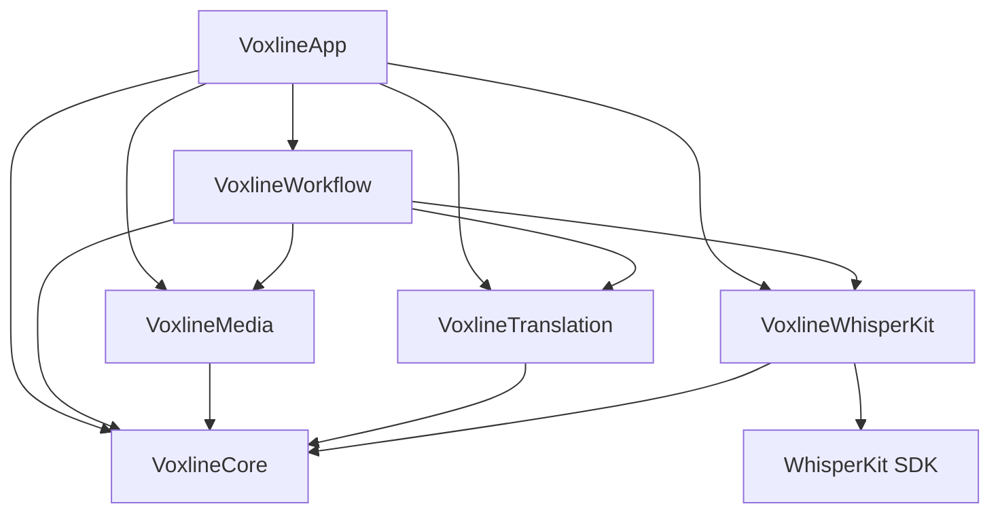

# 当前工程边界

Mac 采用 SwiftPM，iOS 采用 Xcode 工程。依赖提交由 Package.swift / Package.resolved 锁定，Mac 只链接 WhisperKit 产品。工具链、构建与产物统一见 [开发工作流](../development.md)。

两平台使用 Sources/Voxline/App 和同一 VoxlineApp 入口。平台原生适配放在 Platform/macOS、Platform/iOS，使用条件编译；任务状态、模型与翻译设置、原生材质组件在 Views 内共用。Apple 系统翻译接线在 Pipeline 内共用。iOS 通过原生导航进入模型管理、服务配置与语言准备，并能继续导入成果中已完成转写的媒体翻译；本机 Task 创建和转写入口仍待接入。

iOS 的 Core、Media、WhisperKit、Translation 与 Workflow 框架直接编译同一份源码，WhisperKit 集成框架只链接固定版本的 WhisperKit 软件包产品。导入 .voxline / JSON 后验证、迁移并保存独立副本到本地 Documents。同任务 ID 再次导入须确认覆盖本地校对，原文件不写回，Mac 书签不传入 iOS。

## 模块职责

- VoxlineCore：ProcessingTask、参数快照、有序媒体条目、字幕版本、媒体身份、JSON 编解码、验证、转写协议、原始证据、字幕切分与检查点。阶段状态和文本、SRT 生成与导出也在此模块；SRT 文件写入使用调用方传入的 URL，不管理设备目录。只依赖 Foundation，不保存设备路径、书签或密钥。
- VoxlineWhisperKit：固定模型清单、下载与安装校验、本地占用、实例生命周期、有界输入 Provider 和 ModelManager 的可观察状态。SDK 类型只存在于该模块；应用接收真实下载、加载和推理状态。同一进程复用唯一已加载实例。
- VoxlineMedia：AVFoundation 原生能力检查、流式 SHA-256、设备本地书签、有界 PCM 提取和共用播放器。Mac 字幕烧录的快照、合成、预览与导出在此模块，使用 macOS 条件编译；iOS 尚未接入烧录。AVFoundation 类型不进入 Core 或 Task 文件。
- VoxlineTranslation：聊天客户端、上下文批次、结果校验、HTTP 错误、设备服务元数据和异步 Keychain 凭据。依赖 Foundation、Observation、Security 与 Core，不依赖应用或 SwiftUI。
- VoxlineWorkflow：TaskLibrary、单执行者 TaskProcessingQueue 与媒体／翻译外部调用边界。依赖 Core、Media、WhisperKit、Translation；组织实际操作、恢复与原子成果提交，不导入 AppKit、SwiftUI 或应用模块。翻译执行实例由应用接线传入。
- VoxlineApp：两平台入口、主要页面、导航与原生适配。MacWorkflow 配置任务目录与系统最近文档；翻译引擎接线和 Apple Translation 视图会话共用，视图会话保持在稳定根页面。iOS 设备副本库适配同一 TaskLibrary 和 TaskProcessingQueue，当前只允许已完整转写的媒体继续冻结参数中的翻译。UI 不导入第三方 WhisperKit SDK。

Core 和字幕文档不依赖 UI、AVFoundation 或具体推理 SDK。JSON 是持久字幕权威来源，SRT 是导出物，内存任务库是界面状态。

模块依赖如下；Mac 使用 SwiftPM，iOS 使用同源码框架及固定软件包产品。

底层模块不得反向引用应用。测试直接依赖被测模块；应用接线中的协议映射由应用测试覆盖，页面交互和系统视图会话须在目标平台验收。选择理由见 [ADR-0016](../ADR/0016-workflow-and-capability-ownership.md)。

## Task 持久化

Mac 新任务保存至应用本地 Application Support/Voxline/Tasks；导入已有文件后保存到原 URL，不保留额外副本。Workflow 的 TaskLibrary 由调用方传入目录，系统最近文档通过 Mac 接线提供；登记不写文件，保存先编码验证，再原子写入，成功后更新任务库。条目只能由任务库发布。两平台的媒体编辑共用 updateItem，对照最新媒体快照后保存；读写或目录错误明确显示，损坏任务保留错误条目，保存失败保留界面草稿与最后成功写入的成果。iOS 设备副本规则见“iOS 本地播放与校对”。

版本 5 的 .voxline 根对象为 ProcessingTask。版本 2／3／4 迁移保持 Task、媒体、参数、字幕与状态，不虚构检查点；版本 1 的 SubtitleProject 保持原项目 ID 为媒体 ID，复用书签，已有字幕标记为待确认。打开只迁移内存结构，不主动改写原文件；明确保存才写版本 5。运行媒体及内部转写块／翻译批次转换为 interrupted，保留已提交成果。

Task 保存一份参数，有序媒体条目分别保存来源、身份、字幕与状态。整体状态和统计从条目计算。参数冻结要求至少一个可处理媒体，已失败或取消的输入不阻塞其余合法条目。冻结只固定参数，不调用 Provider 或生成成果。

格式、ID、时间、媒体边界、译文来源和失败原因都在编码前与读取后验证。损坏、未来版本或非法数据抛出错误，不创建空 Task 替代原文件。

长期决定见 [ADR-0005](../ADR/0005-task-document-format.md) 与 [ADR-0006](../ADR/0006-single-window-task-library.md)。

## 处理检查点与恢复

MediaProcessingCheckpoint 属于单媒体条目，绑定媒体内容、所选音轨与冻结参数，保存有序转写块和翻译批次。恢复计划必须匹配重新检查的媒体、参数和实际提取范围列表；不匹配明确要求重跑或新建 Task。范围使用提取器声明的整数毫秒，最多 120 秒；相邻范围允许一毫秒的 PCM 量化交集，字幕时间仍须严格有序。

转写块区分 pending、running、interrupted、completed、failed、cancelled。每次实际开始分配新的 sourceID，完成结果必须属于该次运行且符合原范围和转写设置，迟到结果拒绝提交。成功保存完整 SubtitleSegmentationResult，包含原始窗口、文本、策略、来源位置与校对标记；失败／取消保存范围、实际原因与可用证据。异常浮点值以 NaN／+Infinity／-Infinity 字符串保留，NaN 诊断数据的等值比较不会把未改动快照判断为编辑。成功块不会再次加入字幕，也不能用不同结果替换。

媒体的 cues 是可编辑成果，检查点中的切分字幕是不可变原始成果。补交更早失败块时，按声明的块顺序插入，保留其他块的当前文本、时间和译文；若与手工校时冲突则失败，不排序或裁剪。原始切分结果使用同一切分器重新切分证据，确认持久结果与证据一致，避免另养一套来源与时间规则；此验证仅计算结构化文本，不读取音频或运行模型。Task 继续采用全量 JSON、完整验证和原子保存；验证时机调整须先测量，并保持检查点领域操作和持久化入口的完整一致性检查。

转写全部提交后才能建立翻译批次。批次保存字幕 ID、原文、原文版本与已有译文快照；结果必须完整匹配 ID 且译文非空。所有输入仍与当前校对内容一致时才整体提交，原文或译文发生修改则保留编辑并拒绝该结果。时间编辑不使相同原文的翻译失效。完成批次保留历史结果；原文更新后，旧译文保持来源版本并列入待重译。

MediaRecoveryPlan 只列出未完成转写块、可复用的未完成翻译批次、过期批次及尚无当前译文的字幕。成功块／批次跳过；过期批次不能用旧输入继续，当前原文建立新批次。failed／cancelled 范围可在明确恢复或重试时使用计划，不自动启动执行。已知失败、取消或中断不会被其他块／批次的成功掩盖；媒体完成要求全部块提交，并在启用翻译时拥有全部当前译文。

TaskLibrary.commitCheckpoint 在主线程取得最新任务，修改副本、验证并原子写入唯一任务文件，写入成功后才发布结果。界面读取任务库发布的任务，编辑保留独立草稿；参数、字幕、时间偏移和媒体关联均在保存成功后发布，失败显示原因并保留草稿和重试入口。处理结果只读取已发布的最新编辑，草稿提交继续对照当前成果防止覆盖。读写失败不发布新完成状态，也不覆盖最后成功文件。检查点不引用模型、PCM 或诊断缓存路径，缓存清理不影响已提交成果。参数与成果重置入口由明确重跑流程提供，已有字幕不会被初始化检查点覆盖。

长期选择见 [ADR-0010](../ADR/0010-atomic-task-checkpoints.md)。

## 本地顺序执行

TaskProcessingQueue 在应用进程中只有一个执行者，按 Task 的媒体顺序运行。开始或继续时保存冻结参数和待处理状态，已完成媒体、旧格式中没有检查点的已有字幕保持原成果。LocalMediaTranscriptionPipeline 复用 LocalMediaStore、AudioExtractor 与 WhisperModelStore；提取器验证实际内容、所选音轨和缓存，队列以真实提取范围匹配恢复计划，再逐块调用 Provider、切分并提交。成功块跳过，失败块保留证据，其他块和媒体继续。

任务级取消停止后续调度并保存等待项的取消状态；单项取消可以跳过等待项，或取消当前实际操作后继续其他媒体。取消期间占用执行者，直到实际提取或推理返回才允许重试。返回但未提交的原始证据保存为取消记录。提取及转写回调只更新当前操作的显示进度，阶段与完成状态由实际操作和检查点提交驱动。

媒体、范围或手工校时冲突保存为该项失败，原始证据与编辑保留；保存错误停止后续调度，界面明确显示原因。当前运行转为中断；中断状态也无法保存时仅登记内存并明确提示，最后成功文件保持原值。修复文件写入后可继续，或重新打开已保存文件恢复。页面提供开始／继续、任务和单项取消、单项重试及详情校对入口。

启用翻译时，转写全部提交后建立或复用持久翻译批次，完成媒体要求全部当前译文已提交。批次失败停止该媒体的翻译并继续其他媒体，明确重试才重新请求；成功块与批次跳过，过期批次使用当前内容重建。恢复时已完成转写的媒体直接进入翻译，不重复检查或提取音频；仍需转写时保留原生媒体恢复检查。网络请求取消后等待实际操作返回，迟到响应不提交。MediaTranscriptionPipeline 与 SubtitleTranslationPipeline 划定外部调用边界；可控执行仅用于测试，产品实例调用原生媒体、WhisperKit，以及冻结参数指定的实际聊天接口或 Apple Translation。

Core 按媒体检查点推导阶段事实，界面只负责显示：后续翻译失败或取消时，已经完成的音频提取和转写保持完成；尚未开始的翻译保持等待。

## 字幕聊天翻译

Task 冻结服务 ID、地址、模型和目标语言；执行时按服务 ID 取得本地凭据，服务地址与快照不同明确拒绝，不静默切换目的地。聊天协议参照 [OpenAI Chat Completions](https://developers.openai.com/api/reference/resources/chat/subresources/completions/methods/create)，仅发送字幕文本，不发送音频。参数与成果不包含 API 密钥。

每批数量使用任务冻结参数，具体规则见下文“翻译数量与提示词”。序列化的 UTF-8 输入最多 12,000 字节，包括前后各两句上下文。此容量是输入字节上限，不推算服务的模型上下文或费用。过长单句与上下文明确失败，不截断原文。相邻上下文与本批字幕分别发送，只翻译目标 ID；不依赖兼容服务未必支持的 JSON Schema 参数，提示要求纯 JSON 后再严格校验。

响应要求单一完整 assistant 消息、finish_reason 为 stop，以及唯一 translations 数组。结果只允许 id 和 text，完整匹配本批 UUID，拒绝缺项、重复、额外项、空译文、时间字段与 Markdown 包裹。结果通过检查点中的原文版本及已有译文验证后整体提交，模型和目标语言由对应检查点参数保留。失败不以原文填充译文。

429、408、500、502、503、504 和超时允许最多三次自动重试。有效 Retry-After 优先采用秒数或 HTTP 日期；缺失或无效时按 5／15／45 秒退避并增加最多 20% 随机等待。队列显示已译句数、持久批次位置、倒计时、尝试次数及最后错误；等待可立即取消，退出后按中断批次显式恢复，不在重启时自动启动。鉴权、无效参数、其他 HTTP 状态、连接失败及响应校验错误明确失败，不自动重试。重试前核对原文与已有译文快照，编辑后停止请求并保留编辑；提交仍执行同一检查点校验。

临时错误的三次重试耗尽后，批次保存失败原因，媒体保存 translationPaused，任务显示翻译暂停，后续媒体继续。重新读取保持暂停；“继续翻译”复用冻结参数和未完成批次，跳过成功转写及翻译。暂停要求启用翻译、全部转写已提交且存在失败翻译批次，不计为完成；原生播放、校对与原文导出仍可用。版本 5 文档保存引擎选择与暂停状态，新状态不能被旧应用识别时明确拒绝读取。

不自动拆小失败批次或切换模型。网络错误不输出请求头、密钥或上游原始响应正文。服务连通不代替字幕质量验收，实际验证结果统一维护于 Project。

## 本地服务与凭据

TranslationServices.json 保存服务 ID、名称、地址、默认模型及下文“翻译数量与提示词”的参数。密钥由异步 KeychainTranslationCredentialVault 按服务 ID 存入 macOS 本机 generic password；阻塞的系统调用在独立 actor 上执行，不在主线程读取。加载配置只查询凭据条目是否存在，编辑或实际请求时才读取密钥；开发重签名后系统可能要求重新允许读取。不更改钥匙串访问控制。不同步到 iCloud，不进入 Task、导出物或日志。任务调用冻结模型，不因服务默认模型修改而改变；地址与快照不同明确拒绝。

旧明文配置按原 ID 写入 Keychain，全部写入成功后才原子删除 JSON 中的密钥字段；中途失败保持旧文件，重试迁移不产生新 ID。缺失文件表示未配置，损坏文件、钥匙串拒绝及写入失败明确显示，不创建默认服务替代错误配置。读取失败保留最近已读的内存配置，但禁止发起任务请求，直到成功重读或保存有效配置。

保存或删除服务时先更新凭据、再原子提交元数据，失败恢复旧凭据，成功后才发布服务列表。旧凭据恢复失败也明确显示并禁止任务调用。读取或保存期间不并发改写配置；编辑页待读取密钥结束，读取失败且没有明确新密钥时不能把空编辑值覆盖旧值。

配置页、编辑页及任务执行共用同一聊天客户端。连接测试发送一条短文本并调用选定模型，验证实际聊天与 JSON 协议，不以 models 列表成功冒充翻译可用。界面明确说明字幕文本发送到所选服务、音频保持本地；空密钥明确采用无鉴权请求，仅适用于无需密钥的服务，服务要求鉴权时返回具体错误。不重复授权每个媒体，不估算没有可靠依据的费用。选择理由见 [ADR-0011](../ADR/0011-local-translation-credentials.md)。

## 输入与文件访问

任务导入与重新关联使用 SwiftUI 原生 fileImporter，由所在页面呈现文件选择器，不依赖 NSApp.keyWindow 或应用是否处于前台。

TaskConfigurationView 以具体 Task 对象驱动 sheet，在独立草稿上多选 MP4/MOV/M4V、M4A/MP3/WAV，逐项展示能力、失败原因和音轨。多语言音轨必须选择；单音轨可直接选定。错误输入与合法条目共同提交，书签确认失败的新增条目标记失败并保持未关联，便于修复。已有媒体字幕保持原值。

MediaInspector.shared 在进程内复用相同 URL、文件大小与修改时间的检查结果，每次仍打开文件验证实际权限。文件元信息变化后重新计算哈希；确认和重新关联校验内容与所选音轨。新进程首次访问重新检查，不把设备媒体索引写入 Task。缓存不检测大小和修改时间同时保持不变的内容改写。

LocalMediaStore 保持只读沙盒书签，缺失、损坏、授权失败和内容不符均明确处理。播放前验证身份，过期书签经验证后更新；播放期间持有访问，关闭详情释放访问与观察器。原生预览只加入用户选择的音轨，保留源轨道时间和视频变换。Mac 视频画面通过 NSViewRepresentable 承载原生 AVPlayerView，避开 macOS 15 上 VideoPlayer 的框架元数据崩溃；原生控制与字幕浮层仍共用播放器。AVPlayerItem 确认可播放后才启用控制，原生与自定义控件共享 AVPlayer 状态和时间轴；结束及播放中断显式更新。释放或切换媒体后，旧加载、定位和观察回调不能更新新页面。

字幕预览采用开始包含、结束不包含的时间区间，连续字幕在边界切换到下一句。每次媒体详情视图计算一次当前字幕，浮层和参与构建的字幕行复用结果。译文缺失／失败和过期译文明确展示状态。整体偏移先验证全部时间、溢出和媒体边界，再一次替换 cues，保留原文、译文及版本；非法偏移不能产生部分修改。

任务准备等待期间保护原 Task 快照，实际发生修改时拒绝覆盖。取消停止未提交工作。文件访问和恢复只处理实际需求，不加入账户角色、执行租约或云冲突框架。

## 音频提取

AudioExtractor 按媒体条目 ID、内容身份和实际所选音轨管理本地 Caches/Voxline/Audio。读取复用 MediaInspector 的检查，源文件在检查或提取期间变化时明确失败。

AVAssetReader 只读取所选轨道，从第一个非空轨道段开始。输出为 16 kHz、单声道 Float32 PCM，复用一秒写缓冲，按最多 120 秒分块落盘；不把整段音频载入数组。每块记录源时间帧与实际帧数，转为 TranscriptionAudio 时保存绝对毫秒起点，时长向上覆盖不足一毫秒的尾帧。

源时间的前置空段保持起始偏移；系统解码出的内部静音保留；实际时间间隙开始新块，回退明确失败。允许一个输出采样帧的时间量化误差，不排序、裁剪或丢弃音频修复时间轴。

完整解码、源文件检查和结果验证通过后原子写入 audio.json；取消或失败不提交缓存记录。复用前检查内容身份、版本、每块时间与 PCM 文件格式和帧数。缺失、不完整或明确损坏的派生 WAV 发出失效原因并重新提取；仅识别音频文件格式、数据、块结构及 EOF 错误，权限、取消、未知读取错误和源媒体解码或写入错误继续传播。缓存仅在设备本地，不进入 Task 文档。

## 转写 Provider

WhisperKitTranscriptionProvider 固定使用 Task 参数中的模型与语言，未知型号或语言代码明确拒绝。输入为 VXL-008 生成的最多 120 秒、16 kHz 单声道 Float32 PCM，实际帧数必须匹配声明时长。每次只读取一个有界音频块，使用一秒缓冲循环读取全部帧，单次短读不视为 EOF；读取后复用 WhisperModelStore 的唯一模型和单 worker。下载、加载或推理期间，其他模型修改明确返回忙碌错误。

推理直接使用 SDK 音频数组入口及 none 策略，不进入增量读取器、VAD 并发分块及可能跳过失败的合并路径。SDK 内部仍按模型窗口顺序解码；末尾 seek 小于 20 毫秒时不重复发起解码，同时验证实际窗口已覆盖全部输入，防止浮点取整产生仅一帧的重复窗口。不足 20 毫秒的独立输入不能冒充已转写。局部重转写需要先提取目标音频范围并提供正确源偏移，当前 Provider 不接受可被忽略的 SDK 范围参数；Task 范围提取与重转写入口另行接入。

TranscriptionEvidenceSeeker 在 SDK 过滤前记录每个窗口的原始文本、词元、实际帧范围、语言、静音判定及对齐前后段。DTW 输入仅保留真实音频对应的 20 毫秒列；不在输出后修改时间。固定模型的对齐权重为 Float16，其他类型明确失败。WordTimestampAligner 按矩阵逻辑行列读取权重，保持固定 SDK 的 DTW 路径与平局规则，复用其词时长限制和段更新时间；避开 SDK 向带行填充的 IOSurface 按连续行复制权重造成的时间错位。词元、原文、源偏移和真实输入范围保持原值。对齐后出现非空零时长段、时间回退／重叠或窗口越界时，整个窗口回退到对齐前的段解码时间并去除词时间，窗口记录 usesSegmentTimings，对齐后结果保留为诊断证据；段时间也无效时返回失败。只回退整个窗口，避免段时间与相邻对齐段重叠。置信度异常、覆盖缺失或 SDK 遗漏非空文本始终返回失败，不能被时间回退掩盖；不自动重识别或宣告字幕质量通过。

RawTranscriptionSegment 与词时间都使用源媒体绝对秒数；20 毫秒量化误差仅用于边界验证，不排序、截断或消除重复文本。缺失词级信息用 nil 表示，不按字符插值。空文本和静音判定保留在原始记录，字幕切分独立决定其展示规则。

自动语言在每块首个模型窗口显式检测；检测失败或未知代码直接失败，再以确定的代码转写该块，避开 SDK 转写循环的默认语言路径。读取、模型加载、语言检测和解码词元进度来自实际工作，推理错误或协作取消传播为 TranscriptionFailure；失败包含完整输入范围、已收集窗口、尚未提交窗口的解码文本／词元及取消状态。诊断证据以原子 JSON 保存于本地 Caches/Voxline/Transcription，写入失败同时保留内存证据和存储错误。成功只在证据写入后发布；缓存不作为 Task 持久成果，队列通过处理检查点独立提交。异常浮点值以明确字符串保存，不修正成有效时间。

选择与理由见 [ADR-0008](../ADR/0008-bounded-transcription-evidence.md)。

## 可读字幕切分

SubtitleSegmenter 只接受 completed 且无失败原因、未提交文本／词元的 TranscriptionEvidence。段和词必须保持原顺序、有效时间与输入范围；跨段词时间也检查重叠。非空零时长段、词文本遗漏、不合法毫秒时间或越界明确失败，调用者保留原证据并重新识别或人工校时。失败或取消范围不能产生完成字幕，成功块可独立保留；人工校时与局部重识别的执行入口随校对和恢复接入。

每个原始段内部按 SDK 词时间聚合，结合句末标点、停顿标点回溯、静音间隔、最大显示时长与文本宽度切分。英文连续词片段和独立标点保持相连；常见称谓缩写不作为句末。默认宽度 40 列、最长 8 秒、最短 1 秒、静音切分 500 毫秒。宽度按字素计数，CJK／全角与常见表情计两列，其余一列，是文本预算而非字体像素测量。原始段之间保持边界，不合并重叠或重复文本。

词文本与段文本在 Unicode 标准化、忽略空白后必须一致；切分保留词文本，只去除每条首尾空白。空原文仅在其词列表也无非空文本时排除，记录原始段索引。零时长词可随有效对白保留，不能独立构造无效字幕。缺失或空词列表时保留完整段文本与实际段时间，alignment 标记 segment、记录 missingWordTiming；不按字符比例估算内部时间。来自回退窗口的字幕另存 requiresTimingReview，随 Task 文档保存。整词或整段无法满足限制时记录 exceedsWidth／exceedsDuration，供校对处理。

短字幕只向右延长到下一条真实对白起点或当前输入块尾，未达到最短时长时记录 shortDisplay。源段与词时间不修改；延长不覆盖后续对白，也不跨入尚未识别的下一个输入块。

SubtitleSegmentationResult 保存输入证据、策略、字幕及段／词范围来源。sourceID 标识不可变的转写结果，字幕 ID 由该 ID 与原始段及首词位置确定；相同输入和策略重复切分、保存后读取均保持 ID。重新识别使用新的 sourceID；调整策略可能改变边界，不能借 ID 相同自动覆盖手工编辑或复用过期翻译。成功成果通过处理检查点提交到 Task 文档。

选择与理由见 [ADR-0009](../ADR/0009-readable-subtitle-segmentation.md)。

## 执行与界面

MainWindowView 组织任务列表、准备表单、任务详情和媒体详情。NativeControlSurface 在系统 26 及以上使用原生 Liquid Glass，旧系统使用 Material；原生组件优先。系统 26 视觉和辅助功能设置的运行验收由 VXL-049 跟踪（暂缓）。

减少透明度时，自定义控制与字幕浮层使用不透明背景。减少动态效果时，字幕切换取消淡入淡出，当前行与悬停状态即时更新；原生控件沿用系统辅助功能行为。

单句与所选字幕重译复用 TaskProcessingQueue、冻结翻译参数和持久批次，直接调用翻译，不重复提取或推理。覆盖选择列出所选字幕及已有译文；默认保留所有已有译文，覆盖必须明确选择。原始转写检查点须已完成，仍匹配的未完成翻译批次先由队列继续或重试；无转写检查点的历史文档可以浏览和编辑，不能虚构检查点重译。取消等待实际请求结束，提交前继续检查原文版本与已有译文快照。

含 requiresTimingReview 字幕的媒体在转写和翻译完成后保持待校对，检查点拒绝将其标为完成；详情页逐句播放核对后明确确认，全部确认且检查点完成时转为完成。确认只清除标记，不修改时间、原文、译文或检查点。

普通队列重试保留已有译文，包括原文修改后失效的人工译文；存在失效译文时媒体保持待校对，只有明确选择覆盖后才重译。

字幕编辑使用原文／译文草稿，两平台共用 TaskMediaItem.editSubtitle 的版本与状态规则；取消不修改成果。原文改变而译文未编辑时保留旧译文与来源版本，并标记待重译。所有转写块已完成的媒体，在缺少当前译文或仍有时间校对标记时保持待校对，补齐后恢复完成；已有失败、取消或中断及无检查点的历史成果不被编辑宣告完成。请求或其他编辑更新了相同字幕内容时，保存拒绝覆盖并保留草稿。任务写入失败显示错误并保留草稿，任务库与磁盘保持最后成功成果。

禁止计时模拟进度、示例字幕或伪译文。模型安装清单匹配且文件完整时显示已安装；只有当前进程中的 WhisperKit 完成加载才显示已加载。模型规则见 [ADR-0007](../ADR/0007-pinned-local-model-installation.md)。

原始 ASR 证据和可读字幕分开：RawTranscriptionSegment 保留原始对齐，转换为 SubtitleCue 前验证。切分及 Provider 不能排序、裁剪或丢弃文本来伪装成功。过期译文保留旧来源并显示待重译，新的自动处理不能覆盖较新的手工编辑。

应用打包启用 App Sandbox、用户选择文件读写、应用范围书签和网络客户端。iCloud 同步暂废弃；YouTube 来源后续实施；产品只支持 macOS 与 iOS。

## 模型安装与加载

BaselineModel.json 是固定仓库提交、必需文件和摘要的权威清单。Mac 打包复制到应用 Resources，iOS 使用集成框架 Resources；测试使用各自实际资源包。缺少清单明确失败，不读取开发目录替代。模型页面展示清单版本与实际空间，已安装与已加载区分；iOS 不自动选择 Mac 基准模型为新任务默认值，设备资源适用性由真机验证决定。

每个型号的 Application Support/Voxline/Models 目录包含 SDK 缓存、权重、分词器和 installation.json。全部文件的长度与仓库对象摘要通过后才写入安装记录；LFS 使用 SHA-256，普通文件使用 Git blob SHA-1。目录刷新检查记录、版本和文件长度，实际加载前再次校验摘要。

WhisperModelStore 持有一个已加载 SDK 实例。分词器从固定本地目录预解析，实际 SDK 加载完成才显示已加载；进程重启后只识别安装状态。加载实例不可删除或重新下载，卸载释放引用。未知型号明确拒绝，Task 参数页保留旧值。

下载进度是 SDK 的文件完成比例，区分权重、分词器和校验。取消等待实际操作结束，操作标识隔离迟到回调。重新下载清理对应目录后完整下载；部分文件与缓存计入占用并可清理。空间查询、网络、读写和校验错误显示实际原因。决定理由见 [ADR-0007](../ADR/0007-pinned-local-model-installation.md)。

## SRT 导出

单媒体详情以任务参数中的首个输出类型初始化导出，允许选择原文、译文或双语。文件名使用实际源媒体的基础名和 source／translation／bilingual 后缀，不从原文或目标语言猜测语言代码。全部字幕须通过唯一 ID、有序时间、非空正文和媒体时长验证；译文或双语必须每句都有当前原文版本的有效译文，缺失、失败或失效均拒绝整个输出。双语顺序为原文在前、译文在后；换行统一 LF，移除正文中的空白行，避免被识别为新的 SRT 记录。

保存目录由原生文件选择器明确选择，在写入期间取得目录访问，使用 UTF-8 原子写入；已有文件须明确选择覆盖。导出成功显示实际文件名并保留窗口，可继续导出其他类型。校验和写入失败显示原因，既有目标文件保持最后成功内容。iOS 外部播放器兼容性须实际读取成品验证，文件格式检查不能代替播放器验收。

## Mac 字幕烧录

SubtitleBurnInExporter 复用 LocalMediaStore、MediaInspector 与 SRT 的时间／译文版本校验，读取所选音轨和首条视频轨，按源轨道时间与 preferredTransform 构造原生合成。输入为 SDR；检测到 HDR、PQ／HLG、BT.2020 或 P3 时明确拒绝，不作隐式色彩转换。

AVFoundation Core Image 滤镜按 compositionTime 选择开始包含、结束不包含的字幕，先将无限范围的 sourceImage 裁切到 renderSize。Core Text 绘制居中白字、自动换行与深色背景，只缓存当前字幕图像；预览和导出共享同一个不可变字幕快照与视频合成。所有字幕布局在编码前验证，不支持的字体区域与尺寸明确失败。预设选择 H.264／HEVC 和源尺寸最高质量／最高 1080p，原生合成保留源帧时间与画面变换。

原生 audioMix 以单位音量处理所选音轨，避免 AAC 包直接复制缩短轨道尾部。导出后核对音轨起点与终点，允许不足一毫秒的时间刻度量化差异；边界不匹配拒绝发布。

源访问保持到面板关闭。输出目录访问覆盖整个导出过程；先写同目录随机 partial.mp4，导出成功并核对编码、音轨、时长和尺寸后才发布。原视频及其硬链接不能作输出；已有输出需确认覆盖。取消停止原生导出，失败或取消移除临时文件，旧输出保留；临时文件清理失败单独明确显示。进度来自 AVAssetExportSession.states；只在发布成功后显示完成。iOS 观看验收读取实际成品，构建与帧解码不代替播放器验收。

选择理由见 [ADR-0012](../ADR/0012-native-subtitle-burn-in.md)。

## iOS 本地播放与校对

IOSTaskLibrary 为共享 TaskLibrary 提供设备副本入口，导入成果保存为 Documents/<Task ID>.voxline；相同 ID 覆盖前明确确认，正在处理的任务拒绝重新导入覆盖。任务与检查点只由共享任务库发布，不维护第二份结果数组。编辑在草稿中进行，写入前验证文档、媒体快照和字幕原文／译文版本，原子保存成功后才更新任务库。失败保留草稿并显示原因；取消不修改成果。设备副本可通过 Files 取得，导入源文件不写回。

iOS 媒体详情的继续翻译要求任务启用翻译，且媒体拥有非空、全部完成的转写检查点；调用共享队列，不触发音频提取或转写。请求、有限重试、暂停、取消及版本保护保持原有规则。尚未配置的任务服务可按冻结 ID、地址、模型和参数在本设备建立配置，密钥另行输入；修改默认值不改变任务快照。

OpenAI 兼容接口支持显式配置的 HTTPS 与 HTTP 地址，包括本地服务。iOS 声明对应网络传输配置及本地网络用途；访问本地服务时由系统管理网络许可，拒绝或请求失败显示实际错误。

媒体通过原生 Files 选择，MediaInspector 检查实际内容与音轨。检查失败保留原因并提供重新选择；读取、文件变化或取消后可明确重试检查，格式、内容或解码能力不支持时须重新选择文件。已有身份必须匹配原内容和所选音轨；未关联旧成果可明确选择音轨建立身份。媒体保持文件引用，iOS 使用 minimalBookmark 保存设备本地授权，Mac 继续使用只读 security-scoped bookmark。播放共用 MediaPlaybackController，缺失授权或内容变化显示重新关联入口；保存关联期间保持访问并禁止关闭面板。

AVKit VideoPlayer 承载原生音视频播放，字幕浮层和定位共用实际播放器时间。原文修改保留旧译文来源版本并显示待更新；编辑译文后绑定当前原文版本。整体偏移验证完整输入、全部字幕及媒体边界后一次保存，不部分调整。关闭详情释放播放器、书签访问和观察器。

iOS 26 的原生导航及字幕浮层采用 Liquid Glass，旧系统采用 Material；减少透明度时字幕浮层使用不透明系统背景。选择理由见 [ADR-0014](../ADR/0014-ios-local-playback-and-proofreading.md)。

## 翻译数量与提示词

服务配置保存每批字幕数量和系统提示词，Task 准备页继承所选服务并显示本次取值。数量必须为正整数，提示词不能为空；默认每批 30 句，默认提示词保持既有翻译要求。普通翻译和显式重译使用同一分批器及冻结参数。相邻上下文和字幕仍受 12,000 UTF-8 字节容量限制，实际批次可以少于所选数量；客户端在发送前复核该任务数量上限。

可编辑提示词作为 system 消息的翻译要求，随后附加固定的字幕 ID、上下文用途和 JSON 输出协议。自定义提示词不放宽响应校验，未返回全部 ID 或输出无效时批次明确失败。服务参数修改仅影响随后选择或保存参数的未开始任务；已开始任务的翻译、恢复和重译保持文档中的数量与提示词，密钥仍由 Keychain 提供。

缺少新增字段的历史服务和翻译快照迁移为默认 30 句及原翻译提示词；显式空值、错误类型和非法参数拒绝。版本 5 保存带类型的翻译引擎和冻结参数，版本 1／2／3／4 可读取迁移，较旧应用拒绝版本 5，避免以旧默认设置执行新任务。读取不会主动改写历史文件。

## Apple 本地翻译

TranslationSettings.engine 明确保存 OpenAI 兼容接口参数或 Apple 原文语言；目标语言和批量数量共用。Apple 参数不包含服务 ID、地址、模型、系统提示词或密钥。历史扁平翻译配置迁移为 OpenAI 兼容引擎，任务及检查点参数保持一致。

ConfiguredSubtitleTranslationPipeline 按冻结引擎选择唯一执行路径。AppleTranslationCoordinator 在支持列表中匹配语言及等价地区／文字标识，检查语言对；不支持明确失败。任务准备页显示系统支持与安装状态，需要资源时使用 Apple 下载面板。语言准备或翻译失败保留原错误和恢复入口，不请求远端 API。

macOS 15／iOS 18 会话只在稳定根视图 AppleTranslationSessionHost 的 translationTask 闭包中使用，不把会话保存到队列或跨视图持有。系统 26 对已安装语言可创建独立会话；需要下载时继续使用视图会话。语言页可明确准备语言，准备成功只表示语言可用，不产生字幕译文。取消前尚未执行的请求立即结束；SDK 已开始的请求等待实际返回，取消后的结果不提交。iOS 模拟器明确显示本机翻译不可用，实际语言下载和翻译在真机验证。

每条请求用字幕 UUID 作为 clientIdentifier；响应拒绝缺少、重复、额外 ID 和空译文，按输入顺序还原后交给既有检查点验证。批次、原文版本、人工编辑保护、重启恢复与显式重译复用现有流程。Apple 接口接收每条原文，不提供聊天系统提示词；上下文翻译质量通过实际对白对照及人工校对验收。
